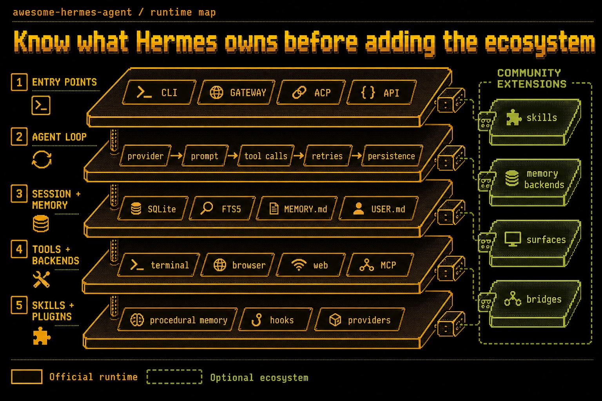
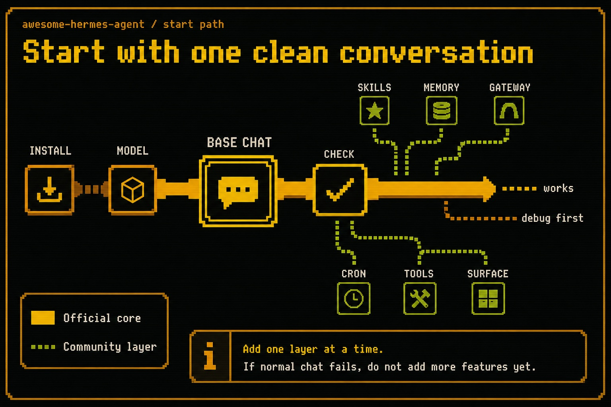
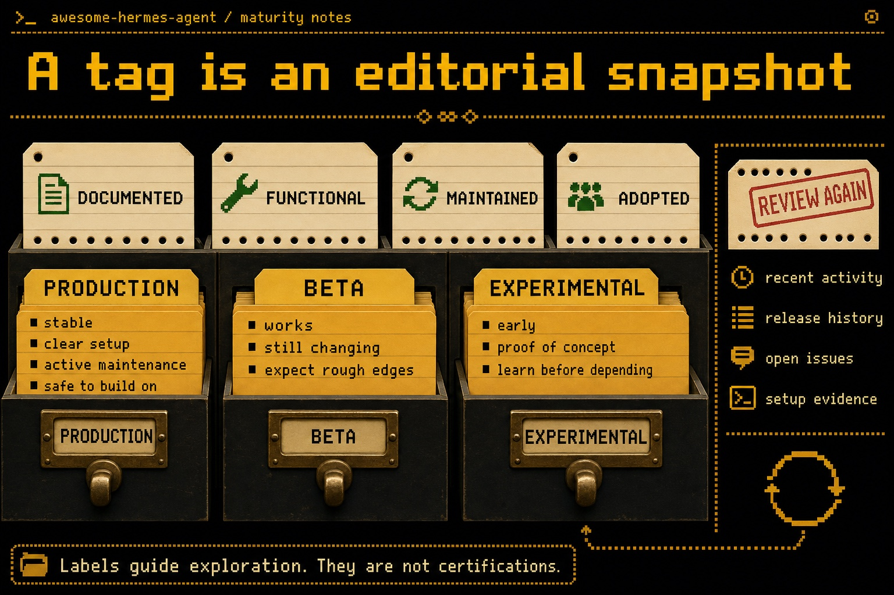
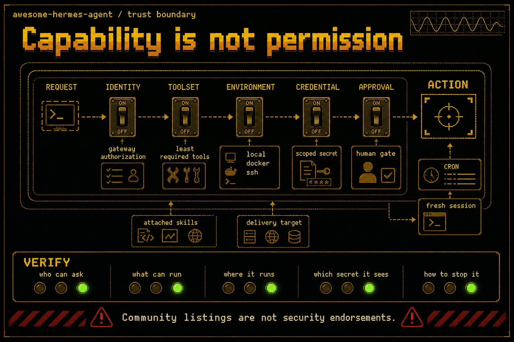

  

  <a href="https://www.nyk.dev/oss/awesome-hermes-agent">nyk.dev/oss</a>
  ·
  <a href="https://github.com/NousResearch/hermes-agent">Hermes Agent</a>
  ·
  <a href="https://github.com/0xNyk/awesome-hermes-agent/blob/main/assets/BRAND.md">品牌资源</a>
  ·
  <a href="https://github.com/0xNyk/awesome-hermes-agent/blob/main/SPONSORS.md">赞助</a>

# Awesome Hermes Agent

> 翻译自 [awesome-hermes-agent](https://github.com/0xNyk/awesome-hermes-agent) 库，本仓库持续同步更新。
>
> 一个精选的技能、工具、集成与资源清单，用于增强你的 [Hermes Agent](https://github.com/NousResearch/hermes-agent) 工作流 —— 这是由 [Nous Research](https://nousresearch.com) 打造的开源自我改进 agent。

Hermes Agent 是由 Nous Research 维护的开源 agent。Awesome Hermes Agent 是 0xNyk 围绕它建立的独立开源目录，收录可选的技能、插件、记忆提供方、交互界面（surfaces）与桥接工具。本目录并非 Nous Research 官方项目。

  

> 生态状态（最后审查时间：2026-07-16）
> - Hermes Agent: [v0.18.2 (v2026.7.7.2)](https://github.com/NousResearch/hermes-agent/releases/tag/v2026.7.7.2)
> - 核心仓库: [NousResearch/hermes-agent](https://github.com/NousResearch/hermes-agent)
> - 发布版本: [Hermes releases](https://github.com/NousResearch/hermes-agent/releases)

---

## 精选推荐

  <em>受到在 Hermes Agent 上持续交付的开发者信赖</em>

<table align="center">
  <tr>
    <td align="center" width="800">
      
       
      <strong>Featured 赞助位</strong> · <a href="https://github.com/0xNyk/awesome-hermes-agent/blob/main/SPONSORS.md">了解更多</a> · <a href="https://buy.stripe.com/bJe14o8AT1xL9cZ8on1wY08">立即参与（$199）</a>
    </td>
  </tr>
</table>

> **注意：** Featured 展示位是付费广告投放，并非安全背书。启用社区工具之前，请务必先[检查信任边界](#check-the-trust-boundary)。

---

## 从哪里开始？

从零到高效使用的三步路径：

1. **跑起来 Hermes：** 按照[官方文档快速开始](https://hermes-agent.nousresearch.com/docs/)操作（安装、CLI、第一次对话）。
2. **添加技能：** [wondelai/skills](https://github.com/wondelai/skills)（覆盖面广的技能库）或 [litprog-skill](https://github.com/tlehman/litprog-skill)（文学化编程）。
3. **添加交互界面：** [hermes-workspace](https://github.com/outsourc-e/hermes-workspace)（Hermes GUI）或 [mission-control](https://github.com/builderz-labs/mission-control)（fleet / 调度仪表盘）。

然后浏览下面的完整列表。每个资源都带有成熟度标签：

  

| 标签 | 含义 |
|-----|------|
| **production** | 稳定、文档完善、持续维护 —— 可以放心在其基础上构建 |
| **beta** | 可以使用，但仍在持续演进 —— 预计会有一些粗糙边角 |
| **experimental** | 概念验证或早期阶段 —— 可以借鉴学习，但不建议依赖 |

  

标签是基于文档质量、安装证据、维护情况和社区采用信号做出的编辑快照。在依赖某个项目之前，请先重新核查其链接指向的现状。

## 检查信任边界

生态收录只是一份发现指南，并非安全背书。在启用社区技能、插件、MCP server 或无人值守任务之前，请核实：谁能触发它、它能拿到哪些工具、命令在哪里执行、它能读取哪些凭据，以及你如何停止它。对不可信的工作，优先使用最小工具集和隔离后端。

  

有关当前可用的控制手段，请使用官方[安全指南](https://hermes-agent.nousresearch.com/docs/user-guide/security/)、[工具参考](https://hermes-agent.nousresearch.com/docs/user-guide/features/tools/)和 [cron 文档](https://hermes-agent.nousresearch.com/docs/user-guide/features/cron)。

关于 `/new`、`/resume`、`/compress`、`/branch`、导出与清理的操作者例行流程，请参阅 [Hermes Agent 会话管理指南](https://www.nyk.dev/blog/hermes-agent-session-management-guide?utm_source=github&utm_medium=readme&utm_campaign=guide&utm_content=awesome-hermes-agent)。

---

## 目录

- [精选推荐](#featured)
- [从哪里开始？](#where-do-i-start)
- [检查信任边界](#check-the-trust-boundary)
- [官方资源](#official-resources)
- [技能与插件](#skills--plugins)
  - [社区技能](#community-skills)
  - [agentskills.io 生态](#agentskillsio-ecosystem)
  - [插件](#plugins)
  - [技能注册表与发现](#skill-registries--discovery)
- [记忆提供方](#memory-providers)
- [工具与实用程序](#tools--utilities)
  - [部署](#deployment)
- [集成与桥接](#integrations--bridges)
- [检测与媒体取证](#detection--media-forensics)
- [多 Agent 与 Swarm](#multi-agent--swarms)
- [领域应用](#domain-applications)
- [分叉与衍生项目](#forks--derivatives)
- [指南与文档](#guides--documentation)
- [运维作战手册](#operational-playbooks)
- [进阶蓝图](#level-up-blueprints)
- [参与贡献](#contributing)
- [许可证](#license)

---

## 官方资源

> 由 Nous Research 维护的核心仓库和资源。

- [Hermes Agent](https://github.com/NousResearch/hermes-agent) by [Nous Research](https://nousresearch.com) - 核心项目。具备封闭学习回路的可自我改进 AI agent，支持技能创建与管理、持久化记忆、20+ 消息平台、六种终端后端（local、Docker、SSH、Singularity、Modal、Daytona）、cron 调度、MCP 集成、隔离 profiles、provider 路由以及从 OpenClaw 自动迁移。215k+ stars。
- [autonovel](https://github.com/NousResearch/autonovel) by [Nous Research](https://nousresearch.com) - 基于 Hermes 构建的自主小说写作流水线。使用 agent 循环端到端生成长篇手稿（100k+ 字）。
- [hermes-paperclip-adapter](https://github.com/NousResearch/hermes-paperclip-adapter) by [Nous Research](https://nousresearch.com) - 让 Hermes 作为 Paperclip 公司中的托管员工运行。将 agent 接入 Paperclip 的任务管理和治理系统。
- [hermes-agent-self-evolution](https://github.com/NousResearch/hermes-agent-self-evolution) by [Nous Research](https://nousresearch.com) - 使用 DSPy 和 GEPA（Genetic Evolution of Prompt Architectures）进行进化式自我改进。这是用于优化 Hermes 自身提示词和行为的研究流水线。
- [Official Documentation](https://hermes-agent.nousresearch.com/docs/) - 全面的官方文档，涵盖快速开始、CLI、配置、消息网关、安全、工具、技能、记忆、MCP、cron、ACP、API server 和架构。
- [Release Notes](https://github.com/NousResearch/hermes-agent/releases) - 官方更新日志，包含每个 Hermes 版本的功能亮点、迁移说明和可靠性修复。
- [tinker-atropos](https://github.com/NousResearch/tinker-atropos) by [Nous Research](https://nousresearch.com) - 独立的 Atropos 集成，接入 Thinking Machines Tinker API。用于在真实 agent 轨迹上微调工具调用模型的 RL 训练基础设施。
- [Skills Hub](https://agentskills.io) - 面向 agent 技能的开放标准。兼容 Hermes、Claude Code、Cursor、Codex 和其他 agent。
- [Discord](https://discord.gg/NousResearch) - Nous Research 社区。用于提交 bug、提出功能请求以及一般讨论。

 

## 技能与插件

> 技能是过程记忆 —— 是 Hermes 从经验中形成并在使用中持续改进的可复用能力。插件则扩展核心功能。

### 社区技能

- **[beta]** [hermes-plugins](https://github.com/42-evey/hermes-plugins) by [42-evey](https://github.com/42-evey) - 插件套件：基于 Gemini Live 的 Discord 语音桥接、WhatsApp 桥接、目标管理、agent 间桥接、模型选择和成本控制。由一位 Hermes 核心高频贡献者维护。
- **[beta]** [hermes-skill-factory](https://github.com/Romanescu11/hermes-skill-factory) by [Romanescu11](https://github.com/Romanescu11) - 可自动从你的工作流中生成可复用技能的元技能。把重复执行的任务交给它，它会为该任务创建一个技能。
- **[beta]** [litprog-skill](https://github.com/tlehman/litprog-skill) by [tlehman](https://github.com/tlehman) - 适用于 Claude Code、OpenCode 和 Hermes 的文学化编程技能。把代码与文字说明编织为有文档、可执行的笔记。
- **[experimental]** [Wizards-of-the-Ghosts](https://github.com/Hmbown/Wizards-of-the-Ghosts) by [Hmbown](https://github.com/Hmbown) - 幻想法术主题技能包。将真实开发操作（重构、lint、测试）包装进桌面 RPG 风格界面中。
- **[experimental]** [super-hermes](https://github.com/Cranot/super-hermes) by [Cranot](https://github.com/Cranot) - 教 Hermes 为自己编写分析型提示词。增加一层元推理能力，让 agent 在执行任务前先为自己生成更好的提示词。
- **[experimental]** [hermes-life-os](https://github.com/Lethe044/hermes-life-os) by [Lethe044](https://github.com/Lethe044) - 个人 OS agent，可检测日常模式并随着时间学习你的习惯。它将 Hermes 的记忆系统用于生活方式追踪，而不只是代码。
- **[beta]** [hermes-incident-commander](https://github.com/Lethe044/hermes-incident-commander) by [Lethe044](https://github.com/Lethe044) - 面向生产事故检测与自愈的自主 SRE agent。它可监控服务、诊断故障并应用修复。与 Hermes 的 cron 调度搭配良好。
- **[beta]** [hermes-dojo](https://github.com/Yonkoo11/hermes-dojo) by [Yonkoo11](https://github.com/Yonkoo11) - 自我改进系统，可监控 agent 性能、识别薄弱技能并自动迭代改进。
- **[beta]** [hermes-spotify-skill](https://github.com/Alexeyisme/hermes-spotify-skill) by [Alexeyisme](https://github.com/Alexeyisme) - 面向无头 Linux 和树莓派 4/5 的 Spotify 播放控制。搜索、播放、暂停、跳过、调节音量、在 Spotify Connect 设备间转移。无守护进程 —— Hermes 生成 spotipy 代码片段并通过 `execute_code` 运行。配合 raspotify 可把树莓派当作音箱。已在 Raspberry Pi OS Lite Bookworm 64-bit 上测试。是生态中唯一的 Linux 原生 Spotify 技能。
- **[experimental]** [hermes-skill-marketplace](https://github.com/Lethe044/hermes-skill-marketplace) by [Lethe044](https://github.com/Lethe044) - 能够自主编写、测试并发布新技能的 agent。自动化技能创建与分发生命周期。
- **[experimental]** [personal-api](https://github.com/beiyuii/personal-api-skill) by [beiyuii](https://github.com/beiyuii) - 在 30 秒内把你的 Obsidian 笔记库变成任何 AI agent 都能读取的身份层。
- **[beta]** [hermes-nextcloud](https://github.com/adnw-vinc/hermes-nextcloud) by [adnw-vinc](https://github.com/adnw-vinc) - 自托管 Nextcloud 桥接 —— 从 Hermes 管理文件（WebDAV）、笔记（Nextcloud Notes API）、日历/任务（CalDAV）和联系人（CardDAV）。App Password 认证、可配置时区、引导式安装。为自建基础设施的 Hermes 用户填补自托管云的空白。
- **[beta]** [oh-my-hermes](https://github.com/witt3rd/oh-my-hermes) by [witt3rd](https://github.com/witt3rd) - 受 `oh-my-claudecode` 启发、基于 Hermes 原语重构的多 agent 编排技能。套件覆盖 deep-research、deep-interview、`ralplan`（Planner → Architect → Critic 共识）、`ralph`（验证执行 → 核实 → 迭代）、`triage` 和 `autopilot`，外加编码调度员手册的 driver 技能。可端到端组合：研究 → 访谈 → 共识计划 → 已验证执行。
- **[beta]** [blacktea](https://github.com/nmrtn/blacktea) by [nmrtn](https://github.com/nmrtn) - 面向通过 x402 在线支付的 agent 的消费管控。超额支付会在聊天中暂停等待人工审批，强制执行 JSON 策略并审计每笔支出。以 MCP server（pay、approve_payment、reject_payment、audit_query）交付，另附 SDK 和 CLI。
- **[beta]** [hermes-skill-kit](https://github.com/duruonanni/hermes-skill-kit) by [duruonanni](https://github.com/duruonanni) - 三个经社区检验的技能：**feishu-document-api**（以编程方式创建飞书/Lark 文档）、**feishu-response-format**（飞书响应格式化，含 3 套表格方案、Card JSON 2.0、Markdown 兼容，53 个测试）和 **hermes-memory-maintenance**（MEMORY.md/USER.md 审计与漂移恢复）。经 Codex 审计。
- **[beta]** [PolyBrain](https://github.com/mosesman831/PolyBrain) by [mosesman831](https://github.com/mosesman831) - 多 agent、多模型编排技能：将目标分解为 JSON 任务计划，并行运行研究与构建子任务，再综合并验证最终答案。每个角色可使用不同的 LLM/提供商。强制严格引用并丢弃无引用的论断。
- **[experimental]** [tech-debt-management-skill](https://github.com/Vincent-crypto-coder/tech-debt-management-skill) by [Vincent-crypto-coder](https://github.com/Vincent-crypto-coder) - Python 项目的系统性技术债管理。自动化扫描（pylint、radon、safety、bandit、flake8），用四维矩阵排定债务优先级，并生成带验证脚本的可执行重构计划。
- **[beta]** [pingpong](https://github.com/0xAaronx0/pingpong) by [0xAaronx0](https://github.com/0xAaronx0) - 自发的本地休闲聚会：agent 向共享看板发布假名化、粗粒度地理范围的邀约；附近的 agent 在本地匹配，并在交换联系方式前通过双向确认协商地点和时间。
- **[beta]** [hermes-skills](https://github.com/RobinBeraud/hermes-skills) by [RobinBeraud](https://github.com/RobinBeraud) - 不断增长的技能库，覆盖金融（FMP 股票/加密货币数据）、网页（Firecrawl 抓取/搜索）、WhatsApp（WBizTool 联系人）以及营销/SEO。每个技能遵循标准 SKILL.md 格式。
- **[beta]** [hermes-skills (liuyunnb666)](https://github.com/liuyunnb666/hermes-skills) by [liuyunnb666](https://github.com/liuyunnb666) - 面向 Hermes 的七个精选技能：调试、并行开发、TDD 和 UI 工作流。
- **[production]** [hermes-skills (winterliu6)](https://github.com/winterliu6/hermes-skills) by [winterliu6](https://github.com/winterliu6) - 中文场景技能包：**content-studio**（小红书/抖音/公众号）、**security-newsletter**（每周网络安全意识邮件）和 **tech-ops-bot**（企业微信/飞书 IT 运维，含故障分类与 Web 仪表盘）。已在 Yaolai 影城 IT 生产环境使用。
- **[beta]** [hurmoz](https://github.com/Moshe-ship/hurmoz) by [Moshe-ship](https://github.com/Moshe-ship) - 阿拉伯语优先技能包 —— 63 个技能，覆盖伊斯兰工具（礼拜时间、天课、古兰经）、方言感知 NLP、内容和旅行。安装：`hermes skills tap add Moshe-ship/hurmoz`。
- **[experimental]** [humanizer-ru](https://github.com/ilyautov/humanizer-ru) by [ilyautov](https://github.com/ilyautov) - 去除俄语文本中的 AI 写作痕迹（公文体、仿译、ChatGPT/Claude 指纹）。52 种模式，确定性离线扫描器。兼容 SKILL.md。MIT。
- **[experimental]** [hinge-projects](https://github.com/tsol/hinge-projects) by [tsol](https://github.com/tsol) - 启动 Vite 项目、Hinge 编辑浮层、Cloudflare 隧道和 Telegram 控制，配合 Hermes 实现基于手机的开发。早期项目；运行安装脚本前请先审查。
- **[beta]** [stock-analysis](https://github.com/AdvancingTitans/stock-analysis) by [AdvancingTitans](https://github.com/AdvancingTitans) - 面向 A 股、港股、美股、基金与投资组合研究的 Python CLI 和便携技能。产出 Markdown 报告和机器可读的证据包；仅用于研究，不含交易执行。
- **[experimental]** [nika-agents](https://github.com/supernovae-st/nika-agents) by [SuperNovae Studio](https://github.com/supernovae-st) - 将 Hermes 中可重复的工作委派给 Nika 工作流，带静态检查、成本上限、许可（permits）和哈希链式执行轨迹。集成技能为 MIT；Nika 仓库为 AGPL-3.0。
- **[beta]** [LinkedIn Skills](https://github.com/sergebulaev/linkedin-skills) by [Serge Bulaev](https://github.com/sergebulaev) - 十个用于起草、评审和规划 LinkedIn 内容的便携技能。MIT 许可，兼容包括 Hermes 在内的 agentskills.io 宿主。
- **[experimental]** [routerbase-agent-skills](https://github.com/zenlee123/routerbase-agent-skills) by [zenlee123](https://github.com/zenlee123) - RouterBase 模型路由与媒体生成技能。需要 RouterBase 凭据；MIT 许可，仍处于初始公开版本。
- **[experimental]** [skill-evolution](https://github.com/okdk7788/skill-evolution) by [okdk7788](https://github.com/okdk7788) - 面向已学习 agent 技能的 GEPA 式可度量进化，将 Hermes 自我改进思路适配到 Claude Code。MIT 许可，仍处于初始公开版本。
- **[beta]** [emulo](https://github.com/ohad6k/emulo) by [ohad6k](https://github.com/ohad6k) - 将本地 Claude Code、Codex 和 Copilot 会话日志挖掘为可移植的用户画像，供 Hermes 作为技能加载。本地运行，MIT 许可。
- **[experimental]** [code-assembly-skill](https://github.com/baoyu0/code-assembly-skill) by [baoyu0](https://github.com/baoyu0) - 搜索优先的软件组装方法：在编写新代码前先寻找并组合现有工具。可跨 Hermes、Claude Code 和 Codex 移植。
- **[experimental]** [hermes-do-task-skill](https://github.com/baoyu0/hermes-do-task-skill) by [baoyu0](https://github.com/baoyu0) - 一条命令完成规划任务、委派执行、验证结果并写入交接说明的工作流。早期项目，尚无正式发布。
- **[beta]** [hermes-telegram-checklist](https://github.com/johnsje183/hermes-telegram-checklist) by [johnsje183](https://github.com/johnsje183) - 原生 Telegram 待办清单（聊天和 forum 话题中真正可交互的复选框与进度计数）—— 支持 create、read、append、toggle，带写入白名单和离线计划校验。因为 Bot API 无法在群组中发布清单，所以使用 Telethon 用户会话（MTProto）；请妥善对待该会话账号。MIT，CI 覆盖 Python 3.9–3.13。
- **[beta]** [hermes-tour-assistant](https://github.com/MaikD77/hermes-tour-assistant) by [MaikD77](https://github.com/MaikD77) - 三合一户外技能套件：**Outdoor Tour Assistant**（GPX 路线监控，带天气、偏航提醒和默认静默的 cron）、**City Walk Guide**（基于 OSM/Wikipedia 的个人城市漫步导览，故事附来源，可选语音）和 **Live Location Nearby**（通过 OSM/Overpass 查找水源、餐饮、维修点和庇护所）。MIT，Python 3.11+，85%+ 测试覆盖率。
- **[beta]** [weread-notes-export-skill](https://github.com/dongwei6688/weread-notes-export-skill) by [dongwei6688](https://github.com/dongwei6688) - 微信读书笔记导出：高亮与想法的章节树 Markdown，支持每日 cron 的增量同步、安全文件名、同书名不同作者的区分。纯 Python 标准库；需要 WeRead API key。
- **[beta]** [policy-search-china-skill](https://github.com/dongwei6688/policy-search-china-skill) by [dongwei6688](https://github.com/dongwei6688) - 检索 16 个部委的中国政府政策文档，并为报告与规划提取带来源链接的逐字引用。内置大型本地政策缓存和脚本化搜索链；双空间布局将用户数据与系统更新隔离。MIT。
- **[beta]** [true402-token-safety](https://github.com/true402/hermes-skills) by [true402](https://github.com/true402) - 交易前的 Base 链（8453）ERC-20 安全闸门：免 Gas 的链上买入→卖出模拟，验证代币是否*能被卖出*，外加流动性与所有权/铸造/代理检查，返回 `avoid` / `caution` / `ok`。每日免费检查无需钱包；更重的使用通过 x402 按次付费，客户端硬性上限 $0.10。MIT-0 许可，封装 `@true402.dev/rugcheck`。
- **[beta]** [twitr-skills](https://github.com/lnvestor/twitr-skills) by [lnvestor](https://github.com/lnvestor) - 五个 X/Twitter agent 技能：实时读取与搜索、批量数据集导出、实时账号/关键词监控（HMAC 签名 webhook）、通过已连接账号发布，以及面向 Hermes cron 的无人值守在线例程。按次以 USDC 计费（Base/Solana 上的 x402，Tempo 上的 MPP）—— 无需 API key 或注册；请将发布/在线技能视为高权限。MIT。
- **[experimental]** [loremaster](https://github.com/loremaster-ai/loremaster) by [loremaster-ai](https://github.com/loremaster-ai) - 从生产级多项目部署中提炼的 AI 敏捷教练与 PM 技能包。带规划扑克的 Sprint 仪式、带可验证完成标准的待办事项提案、计划冲突检测，以及带知识图谱的每项目 wiki vault。所有外部写入（Jira、wiki 提交）都经过逐项人工审批。MIT。
- **[experimental]** [hermes-backup-recovery](https://github.com/JimmyHuang2002/hermes-backup-recovery) by [JimmyHuang2002](https://github.com/JimmyHuang2002) - 让长期运行的 Hermes 始终可恢复：对 `$HERMES_HOME` 下的所有内容（记忆、技能、配置、聊天历史）做 age 加密备份，带校验、恢复演练和健康检查。四个简短 bash 脚本加一个 SKILL.md —— 无锁定，存档为普通 `tar.gz`。MIT。
- **[experimental]** [obsidian-auto-context](https://github.com/SkillForge-Labs/obsidian-auto-context) by [SkillForge Labs](https://github.com/SkillForge-Labs) - 将每次会话的发现、决定和行动项以带标签、wiki 链接的 Markdown 捕获进 Obsidian vault，并汇总到每日笔记。所有内容落盘前先做机密脱敏。MIT。
- **[experimental]** [appnz-agent-skills](https://github.com/lee101/appnz-agent-skills) by [lee101](https://github.com/lee101) - [app.nz](https://app.nz) 的便携部署技能：静态站点、服务器应用、scale-to-zero 的 Cog 模型和有界编码 agent 任务，工作流内置目标/成本检查、健康检查和回滚证据。技能为 MIT；部署需要 app.nz 账号并可能消耗付费额度。
- **[experimental]** [url-manager](https://github.com/Piccolo123/url-manager) by [Piccolo123](https://github.com/Piccolo123) - agent 优先的 URL 收藏与知识管理：agent 保存、分类、打标签、搜索和分享网页链接，支持协作共享分类和回传给用户的魔法链接。MIT 客户端 + 托管后端（ai.ocean94.com）—— 首次使用会自动创建账号，收集的链接存储在那里；SKILL.md 要求首次使用前告知用户。
- **[beta]** [OMH（rlaope 的 oh-my-hermes）](https://github.com/rlaope/oh-my-hermes) by [rlaope](https://github.com/rlaope) - 安装在 Hermes 旁边的包装编排层 —— 一条 `omh setup` 安装 80+ 个生成式工作流技能和一个确定性聊天路由器，把自由格式的韩语/英语聊天转为对应的预备工作流，置信度低时倾向澄清而非猜测。编码工作被委派给显式选择的执行器（Codex、Claude Code 或 Hermes runtime），并遵守严格的"预备 vs 观察到"证据边界。156 个用例的双语路由语料和约 1,500 个单元测试在 CI 中把关每次变更。纯 Python，零运行时依赖，从不给 Hermes 打补丁；文档支持四种语言。与上文 [witt3rd 的 oh-my-hermes](https://github.com/witt3rd/oh-my-hermes) 是不同项目。MIT。
- **[beta]** [roadmap-tutor](https://github.com/instax-dutta/roadmap-tutor) by [instax-dutta](https://github.com/instax-dutta) - 把 91 个官方 roadmap.sh 路线图变成可断点续学、一次一个主题的课程，并跨会话跟踪进度。基于 reactflow 图做拓扑排序的学习路径，纯标准库 Python，可在 2GB 内存的树莓派 4 上运行。命令：start、next、done、skip、status、outline、search、goto、switch、prefetch、reset。每周 CI 验证对全部 91 个在线路线图的解析无损。MIT。
- **[experimental]** [hermes-startup](https://github.com/33hodl/hermes-startup) by [33hodl](https://github.com/33hodl) - "第一笔收入"上手技能：带领新操作者从可用的 Hermes 安装走到一个真实的付费成果，而不是停在 demo。
- **[beta]** [alter](https://github.com/alter-persona/alter) by [alter-persona](https://github.com/alter-persona) - 用你自己的文字构建数字人设，让 agent 用你的语气起草，而不是通用语气。Apache-2.0。
- **[beta]** [shopify-app-review-brief](https://github.com/alfredtech2026/shopify-app-review-brief) by [alfredtech2026](https://github.com/alfredtech2026) - 隐私优先的 Shopify 应用评审分诊：产出运维者可审计、经来源核查的工作表，而不是黑盒评分。
- **[experimental]** [schedulala-agent](https://github.com/schedulala/schedulala-agent) by [schedulala](https://github.com/schedulala) - 从 agent 向 12 个平台排期并发布社交帖子。它持有所发布每个平台的凭据，因此请审慎限定其 token 范围。
- **[experimental]** [deed-page-skill](https://github.com/f-o-x11/deed-page-skill) by [f-o-x11](https://github.com/f-o-x11) - agentskills.io 格式的 `SKILL.md`：Hermes 生成报告、看板或小型静态站点后，用一条 `curl -T` 即可发布到 `https://<slug>.deed.page/` 公开网址；首次发布返回一个 owner token，用于后续更新或删除该站点。免费档无需注册、无需 API key。MIT。

### agentskills.io 生态

> 基于 [agentskills.io](https://agentskills.io) 开放标准构建的技能 —— 可在 Hermes 和其他 agent 平台之间兼容使用。

- **[production]** [wondelai/skills](https://github.com/wondelai/skills) by [wondelai](https://github.com/wondelai) - 面向 Claude Code 和 agentskills.io 兼容平台的跨平台 agent 技能。
- **[production]** [youtube-skills](https://github.com/ZeroPointRepo/youtube-skills) by [therohitdas](https://github.com/therohitdas) - 在 Hermes 内置 `youtube-content` 之上增加 YouTube **搜索**、频道浏览、播放列表提取和可靠转录。内置转录抓取在 VPS 上会静默失败，因为 YouTube 屏蔽云 IP 段；该技能改走 TranscriptAPI 后端（每月 1500 万+ 转录量）以避免被封。12 个子技能覆盖搜索 → 获取 → 批量提取。对创作者查询、主题研究和教程自动触发。解决"我的 Hermes 在 5 美元 VPS 上看不了 YouTube"的问题。
- **[production]** [Anthropic-Cybersecurity-Skills](https://github.com/mukul975/Anthropic-Cybersecurity-Skills) by [mukul975](https://github.com/mukul975) - 753+ 个映射 MITRE ATT&CK 的结构化网络安全技能。25k+ stars。
- **[production]** [chainlink-agent-skills](https://github.com/smartcontractkit/chainlink-agent-skills) by [Chainlink](https://github.com/smartcontractkit) - 基于 agentskills.io 规范的官方 Chainlink agent 技能。预言机网络数据、CCIP 和智能合约交互。
- **[production]** [black-forest-labs/skills](https://github.com/black-forest-labs/skills) by [Black Forest Labs](https://github.com/black-forest-labs) - 用于图像生成的官方 FLUX 模型技能。来自 FLUX 创建者的一方技能。
- **[production]** [pydantic-ai-skills](https://github.com/DougTrajano/pydantic-ai-skills) by [DougTrajano](https://github.com/DougTrajano) - 支持 agentskills.io 的 Pydantic AI。为 agent 技能输入和输出增加类型安全的 schema 校验。
- **[beta]** [execplan-skill](https://github.com/tiann/execplan-skill) by [tiann](https://github.com/tiann) - 以完善的生命周期管理方式执行复杂、长时间运行的任务 —— 进度跟踪、检查点和故障恢复。
- **[beta]** [maestro](https://github.com/ReinaMacCredy/maestro) by [ReinaMacCredy](https://github.com/ReinaMacCredy) - 使用 Conductor 规划与 Beads 跟踪进行技能编排。把多步骤技能执行组织成可观测的流水线。
- **[beta]** [bmad-module-skill-forge](https://github.com/armelhbobdad/bmad-module-skill-forge) by [armelhbobdad](https://github.com/armelhbobdad) - 将仓库和文档转换为符合 agentskills.io 标准的技能。输入代码库，输出可安装技能。
- **[beta]** [Agentic-MCP-Skill](https://github.com/cablate/Agentic-MCP-Skill) by [cablate](https://github.com/cablate) - 带有 agentskills.io 校验能力的 MCP 客户端。桥接 MCP 工具服务器与技能标准。
- **[experimental]** [ripley-xmr-gateway](https://github.com/KYC-rip/ripley-xmr-gateway) by [KYC-rip](https://github.com/KYC-rip) - 面向 agent 的 Monero（XMR）区块链网关。让 agent 工作流能够发起私密加密货币交易。
- **[beta]** [skillsdotnet](https://github.com/PederHP/skillsdotnet) by [PederHP](https://github.com/PederHP) - 带 MCP 集成的 agentskills.io C# 实现。是 Python/TypeScript SDK 的 .NET 替代方案。
- **[beta]** [colony-skill](https://github.com/TheColonyCC/colony-skill) by [TheColonyCC](https://github.com/TheColonyCC) - AI agent 与人类共同发布发现、讨论想法、完成任务、赚取 karma 并建立声誉的协作智能平台。社区主页见 [thecolony.cc](https://thecolony.cc)。
- **[beta]** [AgentCash](https://github.com/Merit-Systems/agentcash-skills) by [Merit-Systems](https://github.com/Merit-Systems) - 让 agent 访问 300+ 高级 API，并通过 x402 或 MPP 用钱包余额付费。一台只装了 AgentCash 的全新 Hermes 就已经很能干 —— 从网页抓取到图像生成再到邮件发送，全部通过一个技能完成，还附赠试用的免费 USDC。
- **[beta]** [x-twitter-scraper](https://github.com/Xquik-dev/x-twitter-scraper) by [Xquik-dev](https://github.com/Xquik-dev) - 通过 43 个窄口径 SKILL.md 文件夹提供类型化的 X（Twitter）访问，覆盖读取（搜索、时间线、提及、趋势、文章、书签、for-you）、写入（发帖、DM、关注、资料更新）、批量提取（粉丝、社区、列表、Spaces）、AI 创作（write-tweets、write-threads、optimize、going-viral）、抽奖、监控和 webhook。无浏览器自动化、无抓取 —— 通过 Xquik API 进行类型化 JSON 输入输出。填补 Hermes 社交工作流的 X 空白。
- **[production]** [drawio-skill](https://github.com/Agents365-ai/drawio-skill) by [Agents365-ai](https://github.com/Agents365-ai) - 从自然语言生成 draw.io 图表并导出 PNG/SVG/PDF。SKILL.md 格式，可跨 Claude Code、OpenClaw、Hermes、Codex 使用。当 agent 需要可视化沟通架构或流程、又不想要单独的设计步骤时非常实用。5.8k+ stars。
- **[production]** [open-design](https://github.com/nexu-io/open-design) by [nexu-io](https://github.com/nexu-io) - 本地优先、开源的 Anthropic Claude Design 替代品。31 个可组合技能（Web/移动/deck/仪表盘/文档）覆盖 129 套设计系统（Linear、Stripe、Vercel、Notion、Apple 等），支持图像（gpt-image-2）、视频（Seedance 2.0、HyperFrames）和音频生成。从 PATH 自动检测 15 个编码 agent CLI，并通过 ACP/JSON-RPC 与 Hermes 集成。BYOK 代理、沙箱预览，可导入 Claude Design 导出。78k+ stars。
- **[beta]** [authsome](https://github.com/agentrhq/authsome) by [agentrhq](https://github.com/agentrhq) - 面向 agent 的本地 OAuth2 与 API 凭据代理。通过浏览器 PKCE 或设备码登录一次，凭据保存在本地加密 vault，本地代理在请求时注入，原始密钥永不进入 agent 环境。预配置 45 个提供商（14 个 OAuth2、31 个 API 凭据），包括 GitHub、Google、OpenAI、Linear、Slack、Notion、Resend 和 Stripe。技能用 `hermes skills install agentrhq/authsome/skills/authsome` 安装进 Hermes。MIT。
- **[production]** [outreachmagic](https://github.com/outreachmagic/outreachmagic) by [Outreach Magic](https://github.com/outreachmagic) - GTM 流水线 agent，将 Smartlead、Instantly、HeyReach、PlusVibe、EmailBison、Prosp 和 Calendly 同步到 agent 可查询的本地 SQLite 数据库。
- **[production]** [abvx-agent-skills](https://github.com/markoblogo/abvx-agent-skills) by [markoblogo](https://github.com/markoblogo) - 可审计的跨平台编码 agent 技能包：更小的 diff、以证据为导向的调试、token 控制、浏览器验证和可评审的 `SKILL.md` 工作流，带静态安全审计。
- **[production]** [dev-gtm-claude-skills](https://github.com/Infrasity-Labs/dev-gtm-claude-skills) by [Infrasity-Labs](https://github.com/Infrasity-Labs) - 面向 SEO、GEO（生成式引擎优化）、AI 可发现性和开发者营销的跨平台 agent 技能。
- **[production]** [remoet](https://github.com/remoet-labs/agent-skills) by [remoet-labs](https://github.com/remoet-labs) - 求职与职业发现技能。按实际技术栈搜索科技公司、收藏入围公司、从精选列表拉取职位，并读写开发者档案。由远程 MCP 提供支持，含免费额度。
- **[beta]** [zooidfund](https://github.com/Ales375/zooidfund-skill) by [Ales375](https://github.com/Ales375) - 让 agent 在 [zooid.fund](https://zooid.fund) 上发现、评估并向人道主义众筹项目捐赠 Base 链 USDC。公开的活动浏览、同伴信号评估和直接的钱包到创作者转账。
- **[production]** [longbridge](https://github.com/longbridge/skills/tree/main/skills/longbridge) by [Longbridge Securities](https://github.com/longbridge) - 覆盖美股、港股、A 股和新加坡市场的实时金融行情技能。实时报价、基本面、期权链、投资组合持仓、机构数据和新闻/SEC 文件。需要 Longbridge 账号。125+ 伴随技能。
- **[production]** [hermes-mine-bean](https://github.com/damo-nu11/minebean-skills/tree/main/hermes-mine-bean) by [MineBean](https://github.com/damo-nu11) - 面向 Base 链上 MineBean 5×5 网格协议的 $BEAN 自动挖矿技能。支持零成本 `--no-agent` cron 模式实现无人值守自动化。
- **[beta]** [invinoveritas](https://github.com/babyblueviper1/invinoveritas) by [babyblueviper1](https://github.com/babyblueviper1) - 便携的 agentskills.io 技能 + MCP 配方，用于比特币闪电网络 / USDC（x402）上的按次付费工具。不可逆操作前有治理 `review` 闸门、市场情报、沙箱代码执行和 agent 间支付。
- **[beta]** [arelay-skills](https://github.com/mmmikael/arelay-skills) by [mmmikael](https://github.com/mmmikael) - 通过 [Agent Relay](https://arelay.app) 递送报告、Markdown、HTML、图像和 PDF，支持可选端到端加密。兼容托管或自托管实例。MIT。
- **[beta]** [tiny.place](https://github.com/tinyhumansai/tiny.place) by [TinyHumans](https://github.com/tinyhumansai) - 以便携技能形式交付的 agent 社交网络：认领 @handle 身份、在开放目录中被发现、通过 Signal 协议端到端加密与同伴通信，并通过 x402 以 USDC/SOL 交易。一个 SKILL.md 即可运行于 Hermes、OpenClaw 和任何兼容 agentskills.io 的宿主。GPL-3.0。
- **[beta]** [plasma-wiki](https://github.com/plasma-ai/wiki) by [plasma-ai](https://github.com/plasma-ai) - 用于分层 Markdown 知识库的便携技能和 Python CLI —— 通过 `wiki map`、`wiki search` 和 `wiki read` 进行创建、索引、搜索、读取和 lint。将项目知识保存在 Git 管理的纯 Markdown 中，索引维护是确定性的，无需托管记忆服务或向量数据库。Apache-2.0。
- **[experimental]** [flashdata-mcp](https://github.com/rocosen/flashdata-mcp) by [rocosen](https://github.com/rocosen) - 15 个任务 SKILL.md 加 MIT 许可的 MCP/CLI 客户端，覆盖 Google 网页/新闻/图片/购物/视频/地点搜索与 YouTube 搜索、元数据、已有转录、许可标签、频道等；并附带专门的 [Hermes 插件](https://github.com/rocosen/flashdata-mcp/tree/main/plugins/hermes)。数据请求需要 FlashData 账号、API key 与付费 Credits。

### 插件

- **[experimental]** [hermes-payguard](https://github.com/nativ3ai/hermes-payguard) by [nativ3ai](https://github.com/nativ3ai) - 安全的 USDC 和 x402 支付插件。允许 Hermes 在可配置消费上限和审批流下收付款。
- **[beta]** [hermes-web-search-plus](https://github.com/robbyczgw-cla/hermes-web-search-plus) by [robbyczgw-cla](https://github.com/robbyczgw-cla) - 多提供商网页搜索，支持在 Serper、Tavily、Exa 等之间智能路由。用更好的结果质量和来源多样性替代内置搜索。
- **[beta]** [hermes-weather-plugin](https://github.com/FahrenheitResearch/hermes-weather-plugin) by [FahrenheitResearch](https://github.com/FahrenheitResearch) - 专业级天气插件，包含 NWS 模型图像、NEXRAD 雷达和气象计算。
- **[experimental]** [hermes-wxtrain-plugin](https://github.com/FahrenheitResearch/hermes-wxtrain-plugin) by [FahrenheitResearch](https://github.com/FahrenheitResearch) - 用于从 HRRR/GFS/ERA5 天气模型构建训练数据集的 ML 流水线插件。是天气插件的配套项目，用于构建天气 ML 流程。
- **[experimental]** [hermes-plugin-chrome-profiles](https://github.com/anpicasso/hermes-plugin-chrome-profiles) by [anpicasso](https://github.com/anpicasso) - 通过 CDP 在不同 Chrome profile 间切换浏览器工具。适用于多账号测试或使用不同已保存会话进行浏览。
- **[experimental]** [hermes-cloudflare](https://github.com/raulvidis/hermes-cloudflare) by [raulvidis](https://github.com/raulvidis) - Cloudflare 浏览器渲染插件。通过 Cloudflare 基础设施进行无头浏览，而不是本地浏览器自动化。
- **[beta]** [hermes-codex-skin](https://github.com/FPSUnleashed/hermes-codex-skin) by [FPSUnleashed](https://github.com/FPSUnleashed) - 独立的 Hermes Desktop 视觉插件：Codex 风格的聊天布局，同时保留原生行为、主题、Glass、模型与 Thinking Level 菜单、语音和任务界面，以及本地 Composer 宽度与置顶消息设置。不修改 Hermes 源码、不添加后端、不发起网络请求。MIT。
- **[production]** [Hermes Tweet](https://github.com/Xquik-dev/hermes-tweet) by [Xquik-dev](https://github.com/Xquik-dev) - Hermes Agent 的 X/Twitter 插件，提供搜索、资料/时间线读取和可选发布/关注动作。读取工具需要 `XQUIK_API_KEY`，动作还需要显式设置 `HERMES_TWEET_ENABLE_ACTIONS=true`。
- **[beta]** [evey-bridge-plugin](https://github.com/42-evey/evey-bridge-plugin) by [42-evey](https://github.com/42-evey) - 用于与 Evey（hermes-agent）桥接的 Claude Code 插件。让 Claude Code 与 Hermes 共享上下文并相互交接任务。
- **[beta]** [agent-analytics-hermes-plugin](https://github.com/Agent-Analytics/agent-analytics-hermes-plugin) by [Agent-Analytics](https://github.com/Agent-Analytics) - 为 Hermes 提供原生 Signals 仪表盘标签页，带只读多项目分析、显式时间范围和主题感知 UI。
- **[beta]** [hermes-artifact-relay](https://github.com/eloktev/hermes-artifact-relay) by [eloktev](https://github.com/eloktev) - 原生插件加 MIT 许可的 [artifact-relay](https://github.com/eloktev/artifact-relay) 服务，用于长篇 Markdown 和 HTML 的私密递送。固定版本安装（`--ref 262db8cc06a66fc2b95ee9f55dc32f1a6fb637d4 --no-enable`）。发布/查看凭据分离；无 CDN 执行路径。MIT。
- **[beta]** [hermes-curator-evolver](https://github.com/pingchesu/hermes-curator-evolver) by [pingchesu](https://github.com/pingchesu) - v0.12 内置 Curator 的证据驱动伴侣。将工具/技能/会话事件观测到本地 SQLite，回填既有 `~/.hermes/sessions/*.json` 历史，生成报告和 dry-run 提案，支持可选 Qwen 嵌入 + bge 重排来排序候选，并运行受控的每日自动循环，只追加低风险、有证据支撑的笔记（带备份和回滚清单）。受 SkillClaw 启发，但适配为 Hermes 原生插件钩子，带显式模型选择加入和固定技能安全机制。
- **[beta]** [rtk-hermes](https://github.com/ogallotti/rtk-hermes) by [ogallotti](https://github.com/ogallotti) - 通过 `pre_tool_call` 拦截 shell 命令并将输出经 [RTK](https://github.com/rtk-ai/rtk) 重写的插件，在到达 LLM 上下文窗口前压缩终端输出。shell 命令 token 减少 60-90%，处理 1100 万+ token 的效率为 96.6%。零配置 —— 网关启动时自动加载。实测基准：`cargo test` 90-99%、`git log --stat` 87%、`ls -la` 78%。
- **[beta]** [eagle-eye](https://github.com/willingning-coder/eagle-eye) by [willingning-coder](https://github.com/willingning-coder) - 五层智能技能路由引擎。在每次 API 调用前，通过 Hard Triggers → FTS5 BM25 → 同义词 → 嵌入 → RRF 融合，把 50+ 已安装技能收窄为前 5 候选。使用 `pre_llm_call` 钩子；置信度闸门允许"无匹配"作为有效结果。
- **[beta]** [cronalytics](https://github.com/8bit64k/cronalytics) by [8bit64k](https://github.com/8bit64k) - cron 成本与用量分析。挂钩 `on_session_end`，分析数据存入本地 SQLite，通过仪表盘标签页、CLI 和 agent 技能呈现，用于 cron 健康诊断。多语言（en、zh、zh-TW、es）。
- **[experimental]** [hermes-drive-index](https://github.com/gregoryhorn/hermes-drive-index) by [gregoryhorn](https://github.com/gregoryhorn) - 私有本地 Google Drive 全文搜索索引。将选定文件夹爬取进 SQLite FTS5，暴露 `drive_index_search`、`drive_index_status` 和 `drive_index_update` 工具。Apache-2.0。
- **[beta]** [hermes-feishu-zh](https://github.com/OLDBAI213/hermes-feishu-zh) by [OLDBAI213](https://github.com/OLDBAI213) - 面向中文飞书显示的社区扩展 —— 替换英文 UI 标签、通过 `post` 格式稳定 Markdown，并可选添加带 12 个飞书工具的 `lark-cli-toolbox`。一键安装，带备份/回滚。
- **[beta]** [hermes-snow-search](https://github.com/mlinquan/hermes-snow-search) by [mlinquan](https://github.com/mlinquan) - 全局记忆检索层 —— 跨会话 SQLite FTS5 搜索（约 0.1 秒），覆盖完整消息历史、记忆和事实，支持中英日韩等 CJK/英语自动路由（trigram vs unicode61 分词器），并可通过共享 state.db 跨设备查询。另有 [PyPI](https://pypi.org/project/hermes-snow-search/)。
- **[beta]** [hermes-bus-plugin](https://github.com/mlinquan/hermes-bus-plugin) by [mlinquan](https://github.com/mlinquan) - 消息总线集成插件。自动启动总线守护进程、注册会话为端点、通过 `pre_llm_call` 注入外部消息。提供 `bus_send`、`bus_status` 和 `bus_info` 工具用于跨进程 agent 协调。
- **[beta]** [hermes-motif](https://github.com/Saurav0989/hermes-motif) by [Saurav0989](https://github.com/Saurav0989) - post-tool-call 插件，从实时执行轨迹中挖掘重复子序列，并将其提案为有证据支撑的微技能。n-gram 提取、参数抽象、与既有技能去重。
- **[beta]** [hermes-eval](https://github.com/Saurav0989/hermes-eval) by [Saurav0989](https://github.com/Saurav0989) - 技能回归测试与轨迹质量评分。在技能漂移扩散之前捕获它。以 Atropos RL 格式导出经过质量筛选的轨迹。
- **[beta]** [hermes-live-discord-agent-plugin](https://github.com/Capslockb/hermes-live-discord-agent-plugin) by [Capslockb](https://github.com/Capslockb) - 到 Gemini Multimodal Live 的全双工 Discord 语音桥接 —— 40+ 函数工具、视觉、每用户记忆、会话中途委派和转录。纯 NumPy 编解码管线，带硬清除插话（barge-in）。
- **[beta]** [hermes-dynamic-workflows](https://github.com/lingjiuu/hermes-dynamic-workflows) by [lingjiuu](https://github.com/lingjiuu) - Hermes 版 Claude Code 风格动态工作流。模型编写沙箱化的工作流脚本，用 `agent`、`parallel` 和 `pipeline` 编排子 agent —— 最多 1000 个子 agent，运行可持久化/恢复，带实时仪表盘。
- **[beta]** [custom-dangerous-patterns](https://github.com/scross01/hermes-custom-dangerous-patterns-plugin) by [scross01](https://github.com/scross01) - 添加需要会话审批的自定义终端命令模式。在标准 once/session/always/deny 审批流之上扩展 `hermes custom-dangerous-patterns` CLI 管理。
- **[beta]** [hermes-ops-kit](https://github.com/redoracle/hermes-ops-kit) by [redoracle](https://github.com/redoracle) - 运维与安全插件：凭据管理、provider 健康检查、路由诊断、MCP 安全审计、密钥轮换和用量/成本可观测性。
- **[beta]** [hermes-openai-codex-web-search](https://github.com/bart6114/hermes-openai-codex-web-search) by [bart6114](https://github.com/bart6114) - 用已有 ChatGPT/Codex 登录态将 OpenAI Codex 托管搜索作为 Hermes 网页搜索后端。使用该订阅；无需单独的搜索 API key。MIT。
- **[beta]** [agentplane-hermes-plugin](https://github.com/basilisk-labs/agentplane-hermes-plugin) by [Basilisk Labs](https://github.com/basilisk-labs) - 外部工作者泳道插件，让 Hermes Kanban 中匹配 `agentplane-*` 的受理人改为生成 AgentPlane 监督，而不是 Hermes profile。
- **[beta]** [khwarizmi-hermes-plugin](https://github.com/Moshe-ship/khwarizmi-hermes-plugin) by [Moshe-ship](https://github.com/Moshe-ship) - 通过 `pre_llm_call`/`pre_tool_call` 实现的 LLM 前可靠性预检：恢复隐式引用、对矛盾大声失败（fail loud），并依据约束驱动的白名单对工具调用把关。属于 [Mizan](https://github.com/Moshe-ship/mizan) 套件的一部分。
- **[beta]** [paperclip-hermes-file-access-manager](https://github.com/marospekarik/paperclip-hermes-file-access-manager) by [marospekarik](https://github.com/marospekarik) / Ordillect - 通过 Docker bind mount 实现内核强制的 Hermes profile 文件系统沙箱（而非应用层检查）：被拒路径直接卸载，只读挂载即使 root 也拒绝写入，支持继承、敏感路径遮蔽和 Paperclip UI 一键应用。MIT。
- **[beta]** [hermes-usage-hook](https://github.com/chenwei791129/hermes-usage-hook) by [chenwei791129](https://github.com/chenwei791129) - 在每条回复下方追加 provider 自身的速率限制窗口（Codex 5 小时/每周，MiniMax）。只读读取 Codex OAuth 凭据；可选的 Codex 每周自动重置**默认关闭**（启用后会消耗不可退还的重置额度），并带隐私最小化的 JSONL 审计。建议使用 `hermes plugins install chenwei791129/hermes-usage-hook/plugin`，而非远程 `uv run` 安装器。MIT。
- **[beta]** [hermes-yandex-mail](https://github.com/akinfold/hermes-yandex-mail) by [akinfold](https://github.com/akinfold) - 通过 IMAP 的 Yandex Mail（无第三方代理）：list/search/read/flag/move/delete，App Password 认证。仅读取与整理（无 SMTP 发送）；`BODY.PEEK` 保证读取不标记已读；`YANDEX_MAIL_ACTIONS` / `YANDEX_MAIL_FOLDERS` 白名单会彻底移除不允许的工具。高权限邮箱访问 —— 请收紧白名单。MIT，已上架 PyPI。
- **[beta]** [hermes-yandex-disk](https://github.com/akinfold/hermes-yandex-disk) by [akinfold](https://github.com/akinfold) - Yandex Disk REST API v1 插件：浏览、读取、下载、写入/上传、复制/移动、分享和回收站。直连 `cloud-api.yandex.net`；操作与路径白名单控制 agent 可触碰的范围。高权限云存储 —— 建议从只读开始。MIT，已上架 PyPI。
- **[beta]** [hermes-yandex-calendar](https://github.com/akinfold/hermes-yandex-calendar) by [akinfold](https://github.com/akinfold) - 通过 CalDAV 的 Yandex 日历：列出日历/事件、创建/更新、RSVP、移动、删除。保留未建模的 iCalendar 属性；`YANDEX_CALENDAR_ACTIONS` / `YANDEX_CALENDAR_CALENDARS` 白名单；不可信服务器 XML 经 defusedxml 解析。高权限日历写入 —— 建议先只读。MIT，已上架 PyPI。
- **[beta]** [hermes-yandex-search-api](https://github.com/akinfold/hermes-yandex-search-api) by [akinfold](https://github.com/akinfold) - Yandex Search API 插件：将 Hermes `web_search` 路由到 Yandex，并增加一个带引用的生成式搜索工具。需要付费的 Yandex Cloud API key + folder id。MIT，已上架 PyPI。
- **[beta]** [hermes-plugin-slash-prompts](https://github.com/buihongduc132/hermes-plugin-slash-prompts) by [buihongduc132](https://github.com/buihongduc132) - 将现有 CLI agent 提示词文件（OpenCode、Claude Code、Codex、Gemini CLI）加载为 Hermes 斜杠命令。自动发现六个标准提示词目录，读取 YAML frontmatter/TOML/原始格式，并在一个处理器中统一不同的参数插值语法（`$ARGUMENTS`、`$1`–`$9`、`{{args}}`）。MIT。
- **[experimental]** [cron-status-alert](https://github.com/pnascimento9596/cron-status-alert) by [Paulo Nascimento](https://github.com/pnascimento9596) - 面向超期 Hermes cron 任务和失败投递的 Discord 告警插件，带恢复通知和 `/cron-status` 命令。新项目、采用者少；MIT 许可。
- **[experimental]** [hermes-gate](https://github.com/observer-protocol/hermes-gate) by [Observer Protocol](https://github.com/observer-protocol) - 在钱包操作前依据签名委托授权书检查 agent 支出。当前的 Hermes 绑定可被绕过该闸门的 agent 规避，且仓库未声明许可证。
- **[experimental]** [hermes-delegation-gate](https://github.com/kenpritchard/hermes-delegation-gate) by [Ken Pritchard](https://github.com/kenpritchard) - 在 `delegate_task` 生成子 agent 前增加人工审批，并为无人值守运行提供 block 模式。需要较新的 Hermes 插件钩子实现；MIT 许可。
- **[experimental]** [Extracto](https://github.com/rclarke87/Extracto) by [Rutger Clarke](https://github.com/rclarke87) - 自托管网页抽取插件：优先使用本地 Trafilatura，对重 JavaScript 页面回退到 Jina Reader。无需 API key；早期首个版本。
- **[beta]** [RoBrain](https://github.com/adelinamart/robrain) by [adelinamart](https://github.com/adelinamart) - 自托管决策记忆插件，记录被否决的备选方案，并在 agent 重访时重新呈现其决策原因。使用 Postgres，可用本地模型运行。Apache-2.0。
- **[experimental]** [hermes-agent-abacus-ai](https://github.com/ZoniBoy00/hermes-agent-abacus-ai) by [ZoniBoy00](https://github.com/ZoniBoy00) - 面向 Abacus.AI 模型的图像生成插件。需要 Abacus.AI API key；MIT 许可，仍处于初始公开版本。
- **[experimental]** [agentiker plugin suite](https://github.com/IVRZ-da/agentiker-code-intel) by [agentiker](https://github.com/IVRZ-da) - 三个 Hermes 插件：AST 感知的代码智能、仓库侦察和计划遵循。链接的 code-intel 插件为 MIT 许可；每个插件单独安装。
- **[experimental]** [hermes-doppler](https://github.com/inLeague/hermes-doppler) by [inLeague](https://github.com/inLeague) - Doppler Secrets Manager 插件，为多 profile 网关部署提供按 profile 的密钥隔离。根配置注入 `os.environ`；按 profile 覆盖保持在 profile 机制范围内，支持 merge/overwrite 模式。为使用 Doppler（而非原生支持的 Bitwarden/1Password）的团队填补空白。MIT。
- **[beta]** [ClawRouter-Hermes](https://github.com/BlockRunAI/ClawRouter-Hermes) by [BlockRunAI](https://github.com/BlockRunAI) - 将 [ClawRouter](https://github.com/BlockRunAI/ClawRouter) 添加为原生模型 provider：通过一个本地代理获得来自 9 个提供商的 55+ LLM，按次以 USDC（x402）付费而非逐个配置 API key，带模型选择器、路由配置和用量统计。基于规范 TypeScript 代理的薄 Python 适配层；已上架 PyPI。它管理一个真实钱包（BIP-39，Base + Solana）并推荐 pipe-to-shell 安装器 —— 运行前请审查，且只充值你愿意花掉的金额。MIT。
- **[beta]** [hermes-hookdeck](https://github.com/hookdeck/hermes-hookdeck) by [Hookdeck](https://github.com/hookdeck) - 将 Hookdeck Event Gateway 置于 Hermes 之前以保障 webhook 可靠性的插件 —— 流量突发会被排队，事件去重并在重启后存活，失败的运行可重新投递，进行中的事件在启动/崩溃时恢复。支持 140+ 提供商签名验证方案。无需公网端口/URL。MIT。
- **[beta]** [hermes-hud](https://github.com/Diabloluo/hermes-hud) by [Diabloluo](https://github.com/Diabloluo) - 官方 hermes 仪表盘的用户级插件：本地优先可观测性（健康、预估/实际/未计费成本、会话、cron、通道抖动、事故）。只读核心数据库，127.0.0.1，无出站遥测。与 [joeynyc/hermes-hud](https://github.com/joeynyc/hermes-hud)（一个 TUI）是不同项目。MIT。
- **[beta]** [Hermes Live Voice](https://github.com/bielcarpi/hermes-live-voice) by [bielcarpi](https://github.com/bielcarpi) - 为新的或已保存的 Hermes 聊天提供连续、可打断的语音。在持久 Hermes 运行于后台执行时保持会话可响应，暴露有界的实时进度，重连后报告完成。Apple Silicon 可运行经过测试的本地 HF 语音到语音栈；也支持 Gemini Live 和 OpenAI Realtime。v0.9.2，733 个测试，Docker/打包安装冒烟测试，CodeQL 与依赖审查。
- **[beta]** [TackMark](https://github.com/freehul/tackmark) by [freehul](https://github.com/freehul) - Hermes Desktop 的可视标注插件：在预览 iframe 中加载本地页面，点击元素落标注，向 AI 会话发送结构化反馈（CSS 选择器 + 坐标 + 备注）—— AI 能精确修复对应元素。通过 fetch + srcdoc 注入实现跨域安全，带视口钳制的智能弹层，以及自愈回退的 URL 记忆。MIT。
- **[experimental]** [agent-heartbeat](https://github.com/Love-AronaPlana/hermes-agent-heartbeat) by [Love-AronaPlana](https://github.com/Love-AronaPlana) - 持久心跳插件，定期在同一网关会话中唤醒 agent，保留完整会话上下文。可配置间隔、`/heartbeat` 斜杠命令、带 UTC 偏移的活跃时间窗、空闲自动暂停、`[SILENT]` 支持、热重载配置。17 个单元测试。MIT。
- **[production]** [DashClaw](https://github.com/ucsandman/DashClaw) by [ucsandman](https://github.com/ucsandman) - 面向 agent 的审批与策略层：在风险动作执行前拦截，并按规则阻止或升级。MIT。
- **[beta]** [cronwatch](https://github.com/nicokickcpython/cronwatch) by [nicokickcpython](https://github.com/nicokickcpython) - cron 健康钩子，在任何计划任务失败时告警，无需再起一个 cron 去盯着第一个。
- **[experimental]** [hermes-gondola-provider](https://github.com/Gondola-Market/hermes-gondola-provider) by [Gondola Market](https://github.com/Gondola-Market) - 将 Gondola 作为原生模型 provider：通过 provider 接口接入的 USDC 结算模型市场。
- **[beta]** [Hermes AI Usage Monitor](https://github.com/masterlf/hermes-ai-usage) by [masterlf](https://github.com/masterlf) - 面向 Hermes Desktop 和 Web 仪表盘的只读 provider 配额与按 profile token 遥测。不读取提示词或响应内容。Apache-2.0。
- **[experimental]** [hermes-wechat-image-wait](https://github.com/Master6688-design/hermes-wechat-image-wait) by [Master6688-design](https://github.com/Master6688-design) - 图文合发插件：微信无法把图片和文字作为一条消息发出，Hermes 的微信接口一收到图就交给 AI。本插件让图片等用户的话到了再一起交给 AI（只有图时最多等 60 秒），并在第一张图到达时先回一句提示。不修改 Hermes 源码；已在 Hermes 0.22.2 真机测试。MIT。
- **[beta]** [tenure](https://github.com/otsoa-dubief/tenure) by [otsoa-dubief](https://github.com/otsoa-dubief) - 可撤销的信任层：agent 按动作类别赚取自主权 —— 日常工作默认授信，某类动作首次出错即收回，凭可验证证据重新赚取。每个决定写入签名、哈希链式账本（`hermes tenure verify`），本地改动 24 小时内可撤销。收回/赚回规则来自一项在 OSF 预注册的 agent 自主权研究；无网络、无 LLM 调用，界面支持中文在内 5 种语言，2,600+ 测试。Apache-2.0。

### 技能注册表与发现

- **[beta]** [hermeshub](https://github.com/amanning3390/hermeshub) by [amanning3390](https://github.com/amanning3390) - 浏览、分享和安装 Hermes 社区技能。面向技能发现的社区中心，目前仍较早期，但在持续增长。
- **[production]** [skilldock.io](https://github.com/chigwell/skilldock.io) by [chigwell](https://github.com/chigwell) - 兼容 OpenClaw、Claude Code 和 Hermes 的可复用 AI 技能注册表。成熟的跨平台技能市场，拥有活跃目录。
- **[production]** [Global Chat](https://global-chat.io) by [pumanitro](https://github.com/pumanitro) - 跨 MCP、A2A 和 agents.txt 协议的 agent 发现。可搜索目录收录 18K+ MCP server 和 agent，附免费的 agents.txt 校验器和供编程访问的 MCP server。
- **[beta]** [BundleDex](https://bundledex.net) by [McClawdDigital](https://github.com/McClawdDigital) - 面向 agent 的 OKF（Open Knowledge Format）知识包目录，带 MCP 工具、`llms.txt` 和面向 Hermes 的搜索/提交技能（[bundledex-agent-skills](https://github.com/McClawdDigital/bundledex-agent-skills)）。技能 MIT；目录为托管服务。
- **[production]** [CreatorSkills](https://creatorskills.co) by [CreatorSkills](https://github.com/calebvbi) - 面向内容创作者的 30+ 可下载 AI 技能精选市场 —— YouTube 脚本、赞助分析、内容再利用和受众增长。使用开放 SKILL.md 格式；技能可安装进 Hermes、Claude Code、ChatGPT 和 20+ 兼容平台。
- **[production]** [TypeUI for Hermes](https://www.typeui.sh/docs/guides/hermes) by [Bergside](https://github.com/bergside/typeui) - 设计技能注册表，让 Hermes 构建用户界面时获得更好的上下文。组件与样式指引来自成熟的设计系统厂商。1.4k+ stars。
- **[beta]** [Hexis](https://github.com/Bevel-Software/Hexis) by [Bevel Software](https://github.com/Bevel-Software) - 以 Git 为基础、管理共享 Agent Skills、工具定义和内部上下文的平台。资源保存在 Git 仓库中，通过带角色访问控制的远程 OAuth 连接提供给 MCP 客户端。不是公共技能市场 —— 为团队自己的 SKILL.md 文件夹、工具和上下文提供可评审的存放处。Apache-2.0。

 

## 记忆提供方

> Hermes Agent 的持久化记忆后端。每次安装都需要选择一个 —— [官方文档](https://hermes-agent.nousresearch.com/docs/user-guide/features/memory-providers)介绍配置方式。通过 `hermes plugins` 管理。

- **[production]** [hindsight](https://github.com/vectorize-io/hindsight) by [Vectorize](https://github.com/vectorize-io) - 面向 agent 的长期记忆层，支持 retain / recall / reflect 工作流。可通过插件或 MCP 集成到 Hermes，并支持语义、图谱和时间检索。
- **[beta]** [LWC](https://github.com/JanYork/llm-wiki-cli) by [JanYork](https://github.com/JanYork) - agent 驱动的主动式项目记忆 CLI。基于 SQLite 的 Wiki 与 FTS5 检索、原子变更集、可选文档与代码图谱和有界 MCP 探索，跨会话维护持久的、有源可溯的知识。通过规范的 `using-lwc` 技能实现 Hermes 原生集成、统一的只读 `lwc serve --mcp` 端点和 `pre_llm_call` 生命周期钩子。Apache-2.0。
- **[beta]** [Lians](https://github.com/Lians-ai/Lians) by [Lians-ai](https://github.com/Lians-ai) - 通过 MCP 提供的开源 agent 记忆。本地运行，基于 SQLite，无需 API key。提供当前与时间点回溯、冲突历史、记忆谱系、反馈、重建和可验证的检索回执。双时态事实（什么在何时为真）、显式更正历史和防篡改回执。提供 Python、TypeScript、Go、Java、C SDK。Apache-2.0。
- **[beta]** [Open Index](https://github.com/DrDroidLab/open-index) by [DrDroidLab](https://github.com/DrDroidLab) - 面向领域专用 agent 的结构化上下文层，带类型化知识图谱、混合搜索、读写 MCP 访问和面向 Hermes 的便携安装技能。与会话记忆后端不同，它用类型化的 schema、实体和关系为领域知识建模。支持本地 SQLite 和共享 OpenSearch 部署。MIT。
- **[beta]** [plur-hermes](https://github.com/plur-ai/plur/tree/main/packages/hermes) by [plur-ai](https://github.com/plur-ai) - PLUR engram 存储的 Hermes 原生记忆插件。需要 `@plur-ai/cli` CLI（`npm i -g @plur-ai/cli`）；然后 `pip install plur-hermes`，网关启动时自动发现，无需额外配置。将纠正和偏好捕获为 `~/.plur/` 下的 YAML engram。存储与全部检索都在你的机器上运行 —— BM25 + 本地 BGE-small 嵌入，存储或搜索不依赖外部服务。被选中的 engram 会注入到你本就要发送的提示词中，因此 PLUR 自身不增加网络路径；可选 `plur_sync` 在你配置 git 远程后推送存储。22 个工具，包括 `plur_learn`、`plur_recall`、`plur_inject`、`plur_feedback`、`plur_forget`。检索随反馈评分改进；未使用的 engram 按 ACT-R 衰减。零 Python 运行时依赖。Apache-2.0。
- **[beta]** [honcho-self-hosted](https://github.com/elkimek/honcho-self-hosted) by [elkimek](https://github.com/elkimek) - 面向 Hermes 的自托管 Honcho 记忆后端部署。适用于需要更强跨会话记忆行为且希望本地可控的场景。
- **[beta]** [yantrikdb-hermes-plugin](https://github.com/yantrikos/yantrikdb-hermes-plugin) by [yantrikos](https://github.com/yantrikos) - [YantrikDB](https://github.com/yantrikos/yantrikdb-server) 的 Hermes 原生记忆提供方。默认像 SQLite 一样内嵌（`pip install yantrikdb`，无需服务器或 GPU），可选面向集群的 HTTP 后端。自我维护：`conflicts()` 呈现矛盾而不是静默覆盖，每个 `recall()` 结果都带 `why_retrieved` 原因列表。需要 `yantrikdb>=0.10.0`。
- **[beta]** [flowstate-qmd](https://github.com/amanning3390/flowstate-qmd) by [amanning3390](https://github.com/amanning3390) - 面向 AI agent 的预期式记忆系统，支持 RAG 和向量搜索。在查询真正到达 agent 之前预取相关上下文。
- **[beta]** [Mnemosyne](https://github.com/AxDSan/Mnemosyne) by [AxDSan](https://github.com/AxDSan) - 专为 Hermes 打造的本地优先、亚毫秒级记忆系统。SQLite + sqlite-vec 混合搜索（50% 向量 / 30% FTS5 / 20% 重要性）、BEAM 分层架构（working / episodic / scratchpad），以及带时间感知事实失效机制的时序知识图谱（TripleStore）。原生插件（`hermes memory setup`、`hermes mnemosyne stats`），零外部依赖，完整文档见 [docs.mnemosyne.site](https://docs.mnemosyne.site)。
- **[production]** [mem0](https://github.com/mem0ai/mem0) by [mem0ai](https://github.com/mem0ai) - AI agent 的通用记忆层。多级记忆（用户、会话、agent），带官方 Hermes 集成。
- **[beta]** [honcho](https://github.com/plastic-labs/honcho) by [plastic-labs](https://github.com/plastic-labs) - 带异步用户建模推理的有状态记忆库。随时间构建更丰富的用户表示。
- **[production]** [supermemory](https://github.com/supermemoryai/supermemory) by [supermemoryai](https://github.com/supermemoryai) - 云端与自托管记忆层。单一 API 即可存储和查询 agent 记忆。
- **[beta]** [hermes-lcm](https://github.com/stephenschoettler/hermes-lcm) by [stephenschoettler](https://github.com/stephenschoettler) - Hermes 的无损上下文管理 —— 防止长运行中的会话上下文退化。
- **[beta]** [ClawMem](https://github.com/yoloshii/ClawMem) by [yoloshii](https://github.com/yoloshii) - agent 的端侧记忆层。本地优先，无外部 API 依赖。
- **[beta]** [gbrain](https://github.com/garrytan/gbrain) by [garrytan](https://github.com/garrytan) - 为 Hermes 打造的主见式大脑层。带分类和检索的结构化个人记忆。
- **[beta]** [keepnotes](https://github.com/keepnotes-ai/keep) by [keepnotes-ai](https://github.com/keepnotes-ai) - 反思式记忆层。在上下文相关的时刻存储并重新呈现笔记。
- **[beta]** [Brainstack](https://github.com/yepyhun/Brainstack) by [yepyhun](https://github.com/yepyhun) - agent 的记忆内核栈。分层记忆架构与基于优先级的召回。
- **[beta]** [autocontext](https://github.com/greyhaven-ai/autocontext) by [greyhaven-ai](https://github.com/greyhaven-ai) - 递归自我改进的上下文 harness。自动整理并压缩上下文以保持相关性。
- **[beta]** [sourcevault-code-tools](https://github.com/sourcevault-ai/sourcevault-code-tools) by [sourcevault-ai](https://github.com/sourcevault-ai) - 私有本地代码记忆：语义代码搜索、精确文件读取和带引用的仓库问答，全部通过本地 SourceVault server 在本机完成。MIT。
- **[beta]** [hexus](https://github.com/codenamekt/hexus) by [codenamekt](https://github.com/codenamekt) - Postgres 记忆插件和独立 MCP server。本地 BERT（MiniLM-L6-v2）嵌入让记忆热路径摆脱 LLM 和远程 HTTP 调用，带 pgvector 搜索、多 agent 存储、per-minion 主题和异步写入队列。BSD-3-Clause。
- **[beta]** [hermes-penfield](https://github.com/penfieldlabs/hermes-penfield) by [penfieldlabs](https://github.com/penfieldlabs) - Penfield 知识图谱的记忆提供方 —— 16 个工具、OAuth 2.1 设备流、仅用标准库，并完整实现 MemoryProvider ABC（prefetch、pre-compress、system prompt block）。插件为 MIT，但其背后是付费的 Penfield 云服务（无免费额度）。
- **[experimental]** [Tree Ring Memory](https://github.com/TerminallyLazy/tree-ring-memory-skill) by [TerminallyLazy](https://github.com/TerminallyLazy) - 面向本地文件的技能级记忆卫生：recall、capture、audit、consolidation 和有意的遗忘。此处作为一种方法收录，而非可直接替换的 Hermes 记忆提供方。
- **[beta]** [causal-memory](https://github.com/JingxuanC/causal-memory/tree/main/hermes-plugin) by [JingxuanC](https://github.com/JingxuanC) - 以因果为核心的记忆提供方：扁平事实加上类型化的决策→结果边（caused / enabled / prevented），存储在按 profile 的本地 SQLite 中。接线钩子覆盖系统提示词因果目录、有预算的预取召回和非阻塞的延迟写入；存储位于上下文窗口之外，因此记忆可在 Hermes 压缩后存活。Rust 核心，Apache-2.0。

 

## 工具与实用程序

> 构建在 Hermes Agent 之上或围绕它构建的应用、CLI 和实用工具。

- **[production]** [hermes-workspace](https://github.com/outsourc-e/hermes-workspace) by [outsourc-e](https://github.com/outsourc-e) - 基于 Web 的工作区，包含聊天、终端、记忆浏览器、技能管理器和检查器。是目前最完整的 Hermes GUI。诞生于 Nous Hackathon 2026。
- **[beta]** [hermes-desktop](https://github.com/dodo-reach/hermes-desktop) by [dodo-reach](https://github.com/dodo-reach) - 面向 Hermes 的原生 macOS 工作区，围绕直接、host 优先的 SSH 连接模型构建，带真正的内嵌终端、会话浏览、规范文件编辑、技能浏览和用量指标，无需额外的网关或守护进程层。
- **[production]** [mission-control](https://github.com/builderz-labs/mission-control) by [builderz-labs](https://github.com/builderz-labs) - 面向 AI agent 编排的开源仪表盘。可管理 agent fleet、分发任务、跟踪成本并协调多 agent 工作流。自托管，基于 SQLite。5.7k+ stars。
- **[experimental]** [hermes-neurovision](https://github.com/Tranquil-Flow/hermes-neurovision) by [Tranquil-Flow](https://github.com/Tranquil-Flow) - 带 42 种动画主题的终端神经可视化器。为 agent 活动提供装饰性终端覆盖层。
- **[beta]** [lintlang](https://github.com/hermes-labs-ai/lintlang) by [Hermes Labs](https://github.com/hermes-labs-ai) - 面向人写的 agent 自然语言指令的确定性本地静态分析。
- **[beta]** [nix-hermes-agent](https://github.com/0xrsydn/nix-hermes-agent) by [0xrsydn](https://github.com/0xrsydn) - Hermes 的 Nix 包和 NixOS 模块。通过 Nix flakes 实现完全可复现的部署。
- **[beta]** [openclaw-to-hermes](https://github.com/0xNyk/openclaw-to-hermes) by [0xNyk](https://github.com/0xNyk) - 从 OpenClaw 迁移到 Hermes 的社区工具。它诞生于原生 `hermes-migrate` 存在关键 bug 的时期。对于 Hermes v0.3.0+，更推荐使用原生 `hermes claw migrate` 命令 —— 现在它已覆盖完整迁移路径。
- **[experimental]** [vessel-browser](https://github.com/unmodeled-tyler/vessel-browser) by [unmodeled-tyler](https://github.com/unmodeled-tyler) - 面向 AI 的原生 Linux 浏览器，支持 MCP 控制和自主浏览。这是为 agent 使用场景构建的完整浏览器，而不是无头浏览器封装。
- **[production]** [camofox-browser](https://github.com/jo-inc/camofox-browser) by [jo-inc](https://github.com/jo-inc) - 带 REST API 的隐身无头浏览器服务器 —— 可绕过 Cloudflare、bot 检测和反爬虫。即插即用的 Puppeteer/Playwright 替代品，为 Hermes 自身的浏览器自动化提供支持。7.7k+ stars，MIT，已在生产环境使用。如果你的 VPS 上的 Hermes 总是被封，这就是正确的后端。
- **[beta]** [hermes-ui](https://github.com/pyrate-llama/hermes-ui) by [pyrate-llama](https://github.com/pyrate-llama) - 单文件玻璃拟态 Web UI，带 SSE 流式、工具调用可视化、活动面板、图像分析（Gemini Vision）、会话管理、PDF 导出、技能浏览器、记忆查看器和移动端支持。Python 代理服务器（仅标准库）跑在 3333 端口，无需构建步骤。
- **[beta]** [hermes-webui](https://github.com/sanchomuzax/hermes-webui) by [sanchomuzax](https://github.com/sanchomuzax) - 轻量级进程监控与配置仪表盘。比 hermes-workspace 更简单，更偏重运维。
- **[production]** [Hermes Studio](https://github.com/EKKOLearnAI/hermes-studio) by [EKKOLearnAI](https://github.com/EKKOLearnAI) - Vue 3 + TypeScript 的 Hermes 仪表盘，采用 Backend-for-Frontend 分离。跨多个后端（本地/Docker/SSH/Singularity）的实时流式聊天、8 个消息通道的统一配置、带 30 天趋势的 token/成本分析、cron 任务调度、多 profile 网关管理、带 @mention 路由的多 agent 群聊，以及基于 WebSocket 的内嵌终端。9.1k+ stars。
- **[beta]** [evey-setup](https://github.com/42-evey/evey-setup) by [42-evey](https://github.com/42-evey) - 一条命令搭建完整 hermes-agent 技术栈，附带免费模型和 29 个插件。带有覆盖大多数使用场景的预设默认值。
- **[beta]** [llmtrim](https://github.com/fkiene/llmtrim) by [fkiene](https://github.com/fkiene) - 位于 Hermes 所调用模型之前的本地代理；在每次请求发出前压缩重发的工具 schema、历史和 MCP 工具输出。带质量闸门，因此绝不会增加你的账单。同时也是 MCP server、CLI 和库（Rust、Python、Ruby、Swift、Kotlin、JS/WASM）。MPL-2.0。与 [rtk-hermes](https://github.com/ogallotti/rtk-hermes) 精神相同，但它是传输层代理而非原生 `pre_tool_call` 插件。
- **[production]** [SkillClaw](https://github.com/AMAP-ML/SkillClaw) by [AMAP-ML](https://github.com/AMAP-ML) - 开源伴侣工具，从真实会话数据中自动进化、去重并改进你的技能库。在 Hermes 内置技能创建之上增加任务后进化循环。通过 `~/.hermes/skills` 实现 Hermes 原生集成，带安全流程（`skillclaw doctor hermes` / `skillclaw restore hermes`）。跨多设备和隔离技能仓工作。705 stars，MIT 许可，活跃至 2026-04-17。
- **[beta]** [agenttrace](https://github.com/luoyuctl/agenttrace) by [luoyuctl](https://github.com/luoyuctl) - 本地优先的 TUI/CLI，用于运行后的 agent 会话审计 —— 成本/token 峰值、工具失败、重试循环、延迟缺口、健康评分、异常和会话间 diff。不上传、不上云，MIT。伴随的 SKILL.md（`agenttrace-session-audit`）将审计打包为任何宿主都可运行的技能。
- **[beta]** [agentburn](https://github.com/Socialpranker/agentburn) by [Socialpranker](https://github.com/Socialpranker) - 本地只读分析器，剖析常驻 agent 的钱花在哪里。按来源拆分支出（cron、网关、子 agent、CLI），隔离夜间窗口，遍历消息日志寻找重复读取循环和重试模式，并输出可直接粘贴的配置修复建议而不改动任何东西。`doctor` 会标记 agent 自身的记账缺口，并将总数降级为显式下界。读取 Hermes、OpenClaw 和 Claude Code；Hermes 适配器基于文档化 schema 构建，但尚未在真实安装上验证。仅用 Python 标准库，`uvx agentburn`，MIT。
- **[beta]** [kesha-voice-kit](https://github.com/drakulavich/kesha-voice-kit) by [drakulavich](https://github.com/drakulavich) - 本地优先的 CLI 语音后端。25 种语言的 STT 和经 Hermes command provider 的 TTS，无需 API key。接入 `HERMES_LOCAL_STT_COMMAND` 和 `tts.providers.<name>.type: command`。
- **[production]** [xiaoma-hermes-zh-cn](https://github.com/fresh-claw/hermes-zh-cn) by [fresh-claw](https://github.com/fresh-claw) - 中文本地化与上手包。一条命令安装器为 Hermes 0.14.x/0.13.x 应用 zh-CN UI 文本补丁、网关提示词和配对消息。
- **[beta]** [Atlas Cloud](https://www.atlascloud.ai) by [Atlas Cloud](https://www.atlascloud.ai) - OpenAI 兼容的 API 网关，用于让 Hermes 工作流运行在多个模型家族上 —— 便于在不重构集成的情况下跨提供商比较技能行为。
- **[beta]** [hermes-bus](https://github.com/mlinquan/hermes-bus) by [mlinquan](https://github.com/mlinquan) - 通用 Unix socket 消息总线传输 —— 4 字节帧、端点注册、心跳保活、自动重连。与 hermes-bus-plugin 和 hermes-notify 配套。
- **[beta]** [hermes-notify](https://github.com/mlinquan/hermes-notify) by [mlinquan](https://github.com/mlinquan) - 配置驱动的通知路由器 —— 按消息类型的 YAML 规则匹配、上下文注入、音频播放和 tmux 通知发送器。
- **[beta]** [arabic-agent-eval](https://github.com/Moshe-ship/arabic-agent-eval) by [Moshe-ship](https://github.com/Moshe-ship) - 方言拆分的阿拉伯语函数调用基准（51 项，5 种方言），带公开[排行榜](https://huggingface.co/spaces/Mosescreates/arabic-agent-eval-leaderboard)。
- **[experimental]** [hermes-plugin-guard](https://github.com/mauricemohr88-debug/hermes-plugin-guard) by [mauricemohr88-debug](https://github.com/mauricemohr88-debug) - 启用前对 Hermes 插件做本地静态扫描 —— 审查清单、Python 能力、依赖声明、可能的已提交机密和仓库卫生状况，绝不导入或执行目标代码。支持文本、JSON、SARIF 或 GitHub 注解报告，并附可复用的 CI composite action。是审查辅助而非沙箱。MIT，有 tag 发布。
- **[beta]** [skillcraft](https://github.com/cloudroad-io/skillcraft) by [cloudroad-io](https://github.com/cloudroad-io) - 面向 agent 配置文件（`SKILL.md`、`CLAUDE.md`、`AGENTS.md`、`.cursor/rules`、`.claude/rules`、copilot-instructions）的 linter + 同步 CLI。可插拔规则、以单一 `AGENTS.md` 为规范源并带漂移检查、面向 CI 的 SARIF。厂商中立 —— 适用于 Hermes 和任何读取这些文件的 agent。Python，`pip install skillcraft`，MIT。
- **[experimental]** [codex-stt-bridge](https://github.com/ai-babai/codex-stt-bridge) by [ai-babai](https://github.com/ai-babai) - 复用本地 Codex/ChatGPT OAuth 会话（文件凭据存储）的 STT CLI，让 Hermes 无需 OpenAI Platform key 或本地 Whisper 即可转录语音消息。使用未公开的 Codex Desktop 转录端点 —— 实验性且可能失效；在凭据缺失或过宽时失败关闭（fail closed）。MIT。
- **[beta]** [agent-qa](https://github.com/vostride/agent-qa) by [vostride](https://github.com/vostride) - 自我改进的 QA agent：带记忆的测试 harness，让重复失败为下一轮提供信息，而不是每次冷启动。
- **[beta]** [ai-usage-monitor](https://github.com/TurkeyGuoba/ai-usage-monitor) by [TurkeyGuoba](https://github.com/TurkeyGuoba) - 本地只读用量监控：按 provider 统计缓存命中率、token 和成本。只读取；不向任何地方发送。MIT。
- **[beta]** [agent-trust-kit](https://github.com/mauricemohr88-debug/agent-trust-kit) by [mauricemohr88-debug](https://github.com/mauricemohr88-debug) - 有界的 agent 交接：显式文件包和证据回执，让跨越交接边界的内容事后可审计。
- **[beta]** [SandBase CLI](https://github.com/sandbaseai/cli) by [sandbaseai](https://github.com/sandbaseai) - 跨 2,000+ 模型的 agent 优先 CLI 和 MCP 桥。Apache-2.0。
- **[beta]** [OrcaReplay](https://github.com/Continuum-AI-Corp/OrcaReplay) by [Continuum-AI-Corp](https://github.com/Continuum-AI-Corp) - 在进程与套接字边界录制 Hermes 的一次运行 —— 模型调用、shell 退出码、每一轮的文件改动、MCP 帧落在同一条时间线上 —— 然后断网逐字重放，并从任意检查点换模型分叉调试。位于 Hermes 之外：不装插件、不写 `~/.hermes`；录制用只为该次运行签发、结束即删的一次性 CA 在本地终结 TLS，凭据转发上游但不写入 trace。Apache-2.0。
- **[beta]** [deepseek-pricing-panel](https://github.com/ybbms777/deepseek-pricing-panel) by [ybbms777](https://github.com/ybbms777) - DeepSeek API 峰谷计费面板 + Hermes 技能/CLI：判断当前是高峰（全价）还是空闲（半价）、下一次几点切换，支持按退出码（0 = 空闲、3 = 高峰）把批处理推迟到便宜时段。峰谷规则在工作日/周末之上叠加国务院放假安排；单文件 HTML 面板零依赖、离线可用。MIT。
- **[beta]** [hermes-opencode-quota](https://github.com/1090123627/hermes-opencode-quota) by [1090123627](https://github.com/1090123627) - 给 Hermes TUI（`hermes --tui`）用的单文件零依赖常驻挂件：显示 OpenCode Go 订阅额度的 5h/周/月三个窗口、Zen 预付钱包余额和会话内走势，60 秒自动刷新；刷新失败时保留上次数据并标注新鲜度。放入 `~/.hermes/tui-widgets/` 后 `/widgets-reload` 即装，`/ocbal` 开关。MIT。

### 部署

- **[beta]** [hermes-agent-docker](https://github.com/xmbshwll/hermes-agent-docker) by [xmbshwll](https://github.com/xmbshwll) - 面向 Hermes 的最小化 Docker 沙箱镜像。拉取、运行、完成。
- **[beta]** [hermes-agent-template](https://github.com/Crustocean/hermes-agent-template) by [Crustocean](https://github.com/Crustocean) - 面向 Crustocean 云端 Hermes 部署的生产就绪 Docker 镜像。基础设施连接已预先配置。
- **[experimental]** [hermes-autonomous-server](https://github.com/JackTheGit/hermes-autonomous-server) by [JackTheGit](https://github.com/JackTheGit) - 在 Linux 服务器上使用 systemd 和 cron 进行无头 Hermes 部署。可无人值守运行。
- **[beta]** [Nora](https://github.com/solomon2773/nora) by [solomon2773](https://github.com/solomon2773) - 面向 Docker 或 Kubernetes 上 Hermes 与 OpenClaw fleet 的自托管控制平面。包含生命周期控制、日志、终端与文件访问、RBAC、加密 provider 机密、监控以及 REST、CLI 和 MCP 接口。Apache-2.0。
- **[beta]** [Hermes-OTG](https://github.com/MilkyWay008/Hermes-OTG) by [MilkyWay008](https://github.com/MilkyWay008) - U 盘上的 Hermes —— 用于在不重装整机的情况下抢救损坏的宿主安装。

 

## 集成与桥接

> 将 Hermes 连接到其他平台、设备和服务。

- **[beta]** [hermes-android](https://github.com/raulvidis/hermes-android) by [raulvidis](https://github.com/raulvidis) - 带完整 Python 工具集的 Android 设备桥接。让 Hermes 能与 Android 设备交互并进行控制。
- **[beta]** [hermes-miniverse](https://github.com/teknium1/hermes-miniverse) by [teknium1](https://github.com/teknium1) - 通往 Miniverse 像素世界的桥接工具。作者是 Nous Research 联合创始人之一。
- **[production]** [screenpipe](https://github.com/screenpipe/screenpipe) by [screenpipe](https://github.com/screenpipe) - 本地优先的屏幕与音频采集，为 Hermes 提供关于你看过、说过、听过什么的长期记忆。通过 MCP 连接（`npx -y screenpipe-mcp`，stdio 或 HTTP），提供搜索、活动摘要和会议检测工具。完全在设备上运行。
- **[beta]** [1claw-hermes](https://github.com/1clawAI/1claw-hermes) by [1clawAI](https://github.com/1clawAI) - 将 [1Claw](https://1claw.xyz) 带入 Hermes 的 TypeScript 集成 —— 基于 MCP 的 HSM 加固 vault 密钥获取、可在提示词到达模型提供商前脱敏机密/PII 并阻断提示词注入的 [Shroud](https://docs.1claw.xyz/docs/guides/shroud) TEE LLM 代理 sidecar、每子 agent 身份，以及用于无密钥链上签名的 Intents API。Hermes agent 获得即时、限定范围、可撤销的凭据，而密钥从不进入 agent 上下文。
- **[beta]** [reina](https://github.com/Crustocean/reina) by [Crustocean](https://github.com/Crustocean) - 面向 Crustocean 平台的自主 AI agent。将 Hermes 深度集成到 Crustocean 产品中。
- **[experimental]** [hermes-blockchain-oracle](https://github.com/gizdusum/hermes-blockchain-oracle) by [gizdusum](https://github.com/gizdusum) - Solana 区块链情报 MCP server。通过 MCP 为 Hermes 提供链上分析和钱包数据。
- **[experimental]** [hermes-council](https://github.com/Ridwannurudeen/hermes-council) by [Ridwannurudeen](https://github.com/Ridwannurudeen) - 对抗式多视角 council MCP server。在 agent 作出决定前，让多个 AI 观点先进行辩论。
- **[production]** [Not Human Search](https://github.com/unitedideas/nothumansearch-mcp) by [unitedideas](https://github.com/unitedideas) - 用于发现其他 MCP server 的 MCP server。索引 8,600+ 个对 agent 友好的站点，带 agentic 评分、分类过滤和实时 JSON-RPC 验证。通过 MCP 接入 Hermes，让 agent 自己发现并评估可集成的新工具。线上地址 [nothumansearch.ai](https://nothumansearch.ai)。
- **[experimental]** [NemoHermes](https://github.com/Hmbown/NemoHermes) by [Hmbown](https://github.com/Hmbown) - NVIDIA 能力注册表与 Spark 感知路由层。将计算密集型任务路由到可用 GPU 基础设施。
- **[beta]** [microsoft-workspace-skill](https://github.com/Andrew-Girgis/microsoft-workspace-skill) by [Andrew-Girgis](https://github.com/Andrew-Girgis) - 通过 Microsoft Graph API 的完整 Outlook/Hotmail/Microsoft 365 集成。邮件、日历、联系人、用户资料和忙/闲日程。OAuth2 自动刷新。包含"发送前预览"模式，可防止 shell `$` 变量被破坏 —— 这是 agent 撰写含金额邮件时的真实痛点。
- **[beta]** [agent-android](https://github.com/aivanelabs/ai-rpa/tree/main/skills/agent-android) by [AIVane Labs](https://github.com/aivanelabs) - 面向 Hermes 的 WiFi 局域网优先 Android 控制 —— AIVane 服务运行后无需 USB、ADB 或 root。支持健康检查、应用列表/启动、UI 树检查、点击、文本输入、滑动、导航、截图以及检查→操作→冒烟流程。明确的安全边界：只连接用户提供的设备 URL。
- **[beta]** [clawsocial-hermes-plugin](https://github.com/mrpeter2025/clawsocial-hermes-plugin) by [mrpeter2025](https://github.com/mrpeter2025) - 社交发现网络插件 —— 帮助用户通过自己的 Hermes agent 找到并联系志趣相投的人。功能包括语义兴趣匹配、实时 WebSocket 消息、可分享名片、本地与 Web 收件箱以及 4 种通知模式。所有操作都要求用户显式发起。双语（英语 + 中文），兼容 OpenClaw 版本。
- **[beta]** [mistral-mcp](https://github.com/Swih/mistral-mcp) by [Swih](https://github.com/Swih) - 封装完整 Mistral AI 能力面的 MCP server（stdio + Streamable HTTP）—— 聊天、嵌入、视觉、OCR、Voxtral 音频（转写/合成）、Codestral FIM、agents、审核、分类、文件、批处理。22 个工具、2 个活跃资源，已列入官方 MCP Registry。让 Hermes 用户保留主推理模型，同时把 OCR / 音频 / FIM / 分类路由到 Mistral 的专用端点（免费 Experiment 层每月 10 亿 token）。
- **[beta]** [Hermes Console](https://github.com/dannyshmueli/obsidian-hermes-console) by [dannyshmueli](https://github.com/dannyshmueli) - Hermes Agent 的 Obsidian 集成。在 Obsidian 的标签页终端中运行 Hermes，并通过本地伴随插件桥接选中笔记/光标上下文，agent 运行结束时还有后台状态提醒。
- **[production]** [onequery-cli](https://github.com/wordbricks/skills/tree/main/skills/onequery-cli) by [Wordbricks](https://github.com/wordbricks) - 面向 agent 的受治理只读 SQL 访问。通过集中化凭据、来源能力检查、查询校验、行数限制和审计日志路由，而非直发数据库凭据。Apache-2.0。
- **[beta]** [agentchat-hermes](https://github.com/agentchatme/agentchat-hermes) by [agentchatme](https://github.com/agentchatme) - 将 Hermes 连接到 [AgentChat](https://agentchat.me) 点对点 agent 消息网络。WebSocket 守护进程带 leader-lock 单例、38 个类型化工具和 SOUL.md 身份锚定。沉默是一等公民结果。
- **[beta]** [AgentChat Universal Skill](https://www.agentchat.me/hermes-skill.md) by [agentchatme](https://github.com/agentchatme) - 通过 `curl` 和 Hermes 的 `cronjob` 工具实现自主 AgentChat 接入的自包含 Markdown 技能 —— 无需人工干预。
- **[beta]** [wasl](https://github.com/Moshe-ship/wasl) by [Moshe-ship](https://github.com/Moshe-ship) - 阿拉伯语 MCP server —— 30 个工具（礼拜时间、古兰经、希吉来历、阿拉伯语 NLP）。`pip install wasl-mcp`。
- **[experimental]** [agy-cli bridge](https://github.com/ypnpt6ysmw-bit/agy-cli) by [ypnpt6ysmw-bit](https://github.com/ypnpt6ysmw-bit) - 通过 macOS Keychain OAuth 将 Google Antigravity CLI 和 Antigravity Pro 订阅凭据集成到 Hermes —— 无需 AI Studio API key。
- **[production]** [Spraay x402 Gateway](https://gateway.spraay.app) - 单笔链上交易向多个收款人批量付款，覆盖 13+ 条链。x402 微支付协议下的 151 个付费原语。提供 Hermes 技能或 [MCP server](https://smithery.ai/servers/Plagtech/Spraay-x402-mcp)。
- **[production]** [MeiGen-AI-Design-MCP](https://github.com/jau123/MeiGen-AI-Design-MCP) by [jau123](https://github.com/jau123) - 跨 9 个领先模型（GPT Image 2、Nanobanana 2、Seedream 5.0、Midjourney V8.1、Flux 2 Klein、Seedance 2.0、Happyhorse 1.0、Veo 3.1）加本地 ComfyUI 的 AI 图像 + 视频生成 stdio MCP server。三种后端模式：MeiGen 云、任何 OpenAI 兼容 API（BYOK）或完全离线的 ComfyUI。README 附带经过测试的 Hermes `mcp_servers` YAML，含视频生成工作流所需的超时覆盖。SSRF 加固，R2 上传 24 小时后自动过期。1.5k+ stars。
- **[beta]** [hermes-tag](https://github.com/DanielLi202/hermes-tag) by [DanielLi202](https://github.com/DanielLi202) - 面向飞书/Lark 和 Slack 群组的上下文选择层：@提及 agent 时，它基于有界的每聊天记忆加上选定的证据在主题内回复 —— 仅被提及时回复，无全历史 RAG，无环境自动作答。带 `enabled_chats` 白名单的管理审计与生命周期控制。MIT，双语文档附真实演示录像。
- **[beta]** [consensus-mcp-hermes](https://github.com/ahmdngi/consensus-mcp-hermes) by [ahmdngi](https://github.com/ahmdngi) - 通过 [Consensus](https://consensus.app) MCP server 将 2 亿+ 同行评审论文接入 Hermes 的配置指南 —— 无头环境的 OAuth 走查、mcp-remote 桥接配置和完整的搜索工具参数参考。
- **[beta]** [Publora MCP Server](https://github.com/publora/mcp-server) by [Publora](https://github.com/publora) - 用自然语言向 10+ 社交网络（LinkedIn、X、Instagram、Threads、TikTok、YouTube、Bluesky、Mastodon 等）排期并发布帖子的官方远程 MCP server。托管于 `mcp.publora.com` —— `hermes mcp add publora --url https://mcp.publora.com` 加 Publora API key（付费服务）。弥合起草社交内容与真正发布之间的鸿沟。MIT。
- **[beta]** [Agent37 Gateway](https://github.com/agent37-platform/gateway) by [Agent37](https://github.com/agent37-platform) - 位于本地 Hermes worker（stdio 上的 JSONL）或 OpenClaw 后端之前的 Responses 风格 HTTP/SSE API —— 无论后面是哪个 agent，都提供稳定的请求形态和可重连的流回放，外加 OpenAI 兼容的 `/v1/models`。附带 Bruno collection，无需写代码即可调试。MIT。
- **[beta]** [hermes-connector](https://github.com/CorsenAI/hermes-connector) by [CorsenAI](https://github.com/CorsenAI) - 给予 Hermes 精确会话和用户选定标签页的 Chrome 扩展，本地优先，而非一刀切的浏览器授权。
- **[beta]** [hermes-proxy](https://github.com/TurkeyGuoba/hermes-proxy) by [TurkeyGuoba](https://github.com/TurkeyGuoba) - 独立于 agent 自身网络路径之外的 mihomo 代理管理。MIT。
- **[beta]** [Worklittle Jobs MCP](https://github.com/worklittle/jobs-mcp) by [Worklittle](https://github.com/worklittle) - 官方远程 MCP（mcp.worklittle.com）：搜索 750 万+ 职位，支持签证、薪资、距离过滤，在 AI 应用内滑动投递并保存到 Worklittle 账号。MIT。
- **[beta]** [Aident Loadout](https://github.com/Aident-AI/aident-skill) by [Aident AI](https://github.com/Aident-AI) - 面向 AI agent 的能力层：一次 MCP 配置（streamable HTTP + OAuth）即可接入 1,000+ 应用与 400+ Skills，官方支持 Hermes、Claude Code、Codex、Cursor 等客户端。凭据存于 Aident Vault，动作写入审计。MIT 技能入口。
- **[experimental]** [Hyperconsciousness](https://github.com/louis030195/hyperconsciousness) by [louis030195](https://github.com/louis030195) - MIT 许可的 Rust 加密知识存储：保存加密、仅追加的记录，提供 CLI 与 MCP 检索接口，可限制 agent 能读取的记录类型、标签和授权有效期。开发者 alpha 阶段，API 仍可能变化；授权限制的是服务端返回内容，不会隔离已能访问本机文件或密钥的进程。

 

## 检测与媒体取证

> 用于判断接收到的媒体是真实还是 AI 生成的技能 —— 对会摄取用户提交音频、图像、视频或文本的 agent 来说至关重要。

- **[beta]** [resemble-ai/detect-skill](https://github.com/resemble-ai/detect-skill) by [resemble-ai](https://github.com/resemble-ai) - 面向 agent 的深度伪造检测与媒体安全。检测 AI 生成的音频、图像、视频和文本；追溯音频来源（ElevenLabs、Resemble 等）；应用不可见水印进行溯源；校验说话人身份（Beta）。由 [Resemble AI](https://resemble.ai) 提供支持。核心原则：没有完成的检测结果，绝不宣称媒体为真或为假。

 

## 多 Agent 与 Swarm

> 用于运行多个 Hermes agent，或让 Hermes 与其他 agent 协同工作的框架和工具。

- **[experimental]** [Ankh.md](https://github.com/Abruptive/Ankh.md) by [Abruptive](https://github.com/Abruptive) - TAW Agent x Hermes 多 agent swarm 框架。协调多个 agent 共享目标并分布式执行任务。
- **[experimental]** [gladiator](https://github.com/runtimenoteslabs/gladiator) by [runtimenoteslabs](https://github.com/runtimenoteslabs) - 两家自主 AI 公司为争夺 GitHub stars 而竞争。一个探索自主 agent 竞争动态的黑客松项目。
- **[beta]** [bigiron](https://github.com/supermodeltools/bigiron) by [supermodeltools](https://github.com/supermodeltools) - 基于 Hermes 和 Supermodel 代码图谱的 AI 原生 SDLC。通过协同 agent 驱动完整软件开发生命周期。
- **[beta]** [opencode-hermes-multiagent](https://github.com/1ilkhamov/opencode-hermes-multiagent) by [1ilkhamov](https://github.com/1ilkhamov) - 面向 OpenCode AI 的 17 个专用 agent。每个 agent 都有明确角色，并通过结构化接口通信。
- **[beta]** [MisakaNet](https://github.com/Ikalus1988/MisakaNet) by [Ikalus1988](https://github.com/Ikalus1988) - 基于 Git 的分布式 swarm 记忆。当一个 agent 解决了问题，每个节点都通过 GitHub Issues 同步的共享 Markdown 经验教训学到它。104+ 条经验教训，21+ 个注册节点。除 GitHub 外零基础设施。
- **[experimental]** [hermes-conductor](https://github.com/forcewake/hermes-conductor) by [forcewake](https://github.com/forcewake) - 面向 Hermes 的看板编排多 harness 编码 swarm。编排者负责路由与验证；worker 只有提供可审计证据才能完成卡片。MIT。

 

## 领域应用

> 使用 Hermes 针对特定领域打造的专用应用。

- **[experimental]** [hermes-embodied](https://github.com/bryercowan/hermes-embodied) by [bryercowan](https://github.com/bryercowan) - 通过 VLA 模型微调实现自我改进机器人系统。将 Hermes 的学习闭环应用于真实机器人控制。Nous Hackathon 项目。
- **[beta]** [hermescraft](https://github.com/bigph00t/hermescraft) by [bigph00t](https://github.com/bigph00t) - 面向 Minecraft 的具身 AI 伙伴，具备持久记忆。可追踪库存、学习建造偏好并跨会话保留上下文。
- **[experimental]** [Hermes-mars-rover](https://github.com/Snehal707/Hermes-mars-rover) by [Snehal707](https://github.com/Snehal707) - 基于 ROS2 和 Gazebo 的火星车模拟器。使用 Hermes 的技能创建循环持续改进导航能力。
- **[beta]** [anihermes](https://github.com/rodmarkun/anihermes) by [rodmarkun](https://github.com/rodmarkun) - 本地动漫服务与追踪器，带自然语言界面。可通过对话浏览、追踪并获取推荐。
- **[beta]** [job-scout-agent](https://github.com/Christabel337/job-scout-agent) by [Christabel337](https://github.com/Christabel337) - 自主求职 agent。搜索职位、跟踪申请并管理求职流水线。
- **[beta]** [hermes-ai-infrastructure-monitoring-toolkit](https://github.com/JackTheGit/hermes-ai-infrastructure-monitoring-toolkit) by [JackTheGit](https://github.com/JackTheGit) - 通过 Telegram 实现基础设施监控、成本预测和告警。使用 cron 调度进行持续检查。
- **[experimental]** [hermes-genesis](https://github.com/Ridwannurudeen/hermes-genesis) by [Ridwannurudeen](https://github.com/Ridwannurudeen) - 自主"活世界"引擎，支持程序化生成。创建并维护会随着时间推移愈发复杂的虚拟世界。
- **[experimental]** [hermes-legal](https://github.com/Lethe044/hermes-legal) by [Lethe044](https://github.com/Lethe044) - 支持英语和土耳其语的合同风险分析。识别高风险条款并总结法律义务。
- **[beta]** [hermes-startup-architect](https://github.com/dlkakbs/hermes-startup-architect) by [dlkakbs](https://github.com/dlkakbs) - 从创业想法生成可直接面向投资人的资料包 —— 包括市场分析、路演 deck 和财务预测。
- **[beta]** [mercury](https://github.com/hxsteric/mercury) by [hxsteric](https://github.com/hxsteric) - 带 WebGL 仪表盘的多链区块链现金流分析器。支持链上取证与流向可视化。
- **[beta]** [mycodo-hermes-skill](https://github.com/setasoma/mycodo-hermes-skill) by [setasoma](https://github.com/setasoma) - 面向树莓派上自主蘑菇种植的阶段感知 IoT 决策引擎。通过 Mycodo/InfluxDB 读取传感器、检测生长阶段并带安全防护地触发继电器命令。已通过一个完整的猴头菇出菇周期验证。
- **[production]** [snapmaker-u1-toolkit](https://github.com/bbolinger/snapmaker-u1-toolkit) by [bbolinger](https://github.com/bbolinger) - 通过 Moonraker/Klipper 局域网对 Snapmaker U1 多工具 3D 打印机进行安全分阶段的无头切片。10 步分阶段操作流程，打印启动需相机闸门确认 —— 实测中该闸门在任何加热命令之前拦下了一个错误挤出机的 G-code。附带可通过 `hermes skills install bbolinger/snapmaker-u1-toolkit/skills/3d-printer-slicing-automation` 安装的 Hermes 技能。MIT。
- **[experimental]** [Currents News API Skills](https://github.com/currentslab/news-api-skills) by [Currents](https://github.com/currentslab) - 可安装的新闻搜索与阅读技能，带服务端凭据、参数校验、缓存和速率限制指引。需要 Currents API key；MIT 许可。
- **[beta]** [Internet Court](https://github.com/internet-court/internet-court-skill) by [Internet Court](https://github.com/internet-court) - MIT 许可的便携技能，覆盖 agent 间商务中的委托权限、x402 支付、托管、撤销和争议流程。
- **[beta]** [openInvest](https://github.com/longsizhuo/openInvest) by [longsizhuo](https://github.com/longsizhuo) - 自托管投资研究应用，运行 LLM 委员会并暴露 agentskills.io 与 MCP 接口。MIT 许可；研究产出不构成投资建议。
- **[beta]** [erpclaw](https://github.com/avansaber/erpclaw) by [avansaber](https://github.com/avansaber) - 自托管 ERP 核心，含会计、库存、销售、采购、HR、薪资和 agent 操作层。GPL-3.0，通过其技能接口与 Hermes 兼容。

 

## 分叉与衍生项目

> 将 Hermes 带向新方向的知名分叉和衍生项目。

- **[beta]** [hermes-agent-camel](https://github.com/nativ3ai/hermes-agent-camel) by [nativ3ai](https://github.com/nativ3ai) - 集成 CaMeL 信任边界的 Hermes。为安全关键型部署在 agent 循环中加入正式的信任验证。
- **[experimental]** [orahermes-agent](https://github.com/jasperan/orahermes-agent) by [jasperan](https://github.com/jasperan) - Oracle AI Agent Harness —— 集成 OCI GenAI 与 Oracle 26ai。是面向 Oracle 环境的企业级入口方案。
- **[experimental]** [Hermes Alpha](https://github.com/kaminocorp/hermes-alpha) by [Kamino](https://github.com/kaminocorp) - 由原生 Hermes 加一个 `SOUL.md` 构建的云端安全研究实验。Fly.io 上的 Overseer agent 为漏洞赏金工作创建一次性 Hunter agent，并将经验记录到 Elephantasm。项目自称是进行中的实验；最后一次代码提交是 2026 年 3 月 16 日，且没有发布版本。
- **[experimental]** [hermes-skill-distillation](https://github.com/beardthelion/hermes-skill-distillation) by [beardthelion](https://github.com/beardthelion) - 从真实任务中生成 agentic 训练轨迹。一个用来大规模产出微调数据的黑客松项目。

 

## 指南与文档

> 教程、文档和学习资源。

- **[beta]** [hermes-agent-docs](https://github.com/mudrii/hermes-agent-docs) by [mudrii](https://github.com/mudrii) - 面向 Hermes Agent 的全面社区文档。详细覆盖 v0.2.0，对部署模式是官方文档之外的有用补充。
- **[production]** [hermes-wsl-ubuntu](https://github.com/metantonio/hermes-wsl-ubuntu) by [metantonio](https://github.com/metantonio) - 在 Windows 上通过 WSL2 Ubuntu 运行 Hermes 的分步搭建说明。
- **[beta]** [HermesWiki](https://github.com/martymcenroe/HermesWiki) by [martymcenroe](https://github.com/martymcenroe) - 社区维护的 wiki，汇集使用 Hermes 构建自主 agent 的实用模式与部署建议。
- **[experimental]** [hermes-always-on](https://github.com/JimmyHuang2002/hermes-always-on) by [JimmyHuang2002](https://github.com/JimmyHuang2002) - 在专用硬件（树莓派、mini PC、任何常开 Linux 主机）上 7x24 运行 Hermes 的厂商中立指南：systemd 监管、断电恢复、加密计划备份、恢复演练、健康检查和安全基础。由 MangoTart 团队维护，但不依赖其任何产品。与 [hermes-backup-recovery](https://github.com/JimmyHuang2002/hermes-backup-recovery) 配套使用。

---

## 运维作战手册

> 在生产环境中反复证明对 Hermes 团队有帮助的实用工作流模式。

- **夜间自我进化 + 护栏评估** —— 按计划运行 [hermes-agent-self-evolution](https://github.com/NousResearch/hermes-agent-self-evolution)，再运行第二个验证 cron 对质量进行评分并阻止优化循环作弊。
- **使用 Honcho/Hindsight 处理记忆压力** —— 如果你在重复上下文或丢失长期记忆，请查看 [Honcho Memory docs](https://hermes-agent.nousresearch.com/docs/user-guide/features/honcho)，并评估 [hindsight](https://github.com/vectorize-io/hindsight) 或自托管记忆后端。
- **尽早调整 session timeout/expiry** —— 使用[配置文档](https://hermes-agent.nousresearch.com/docs/user-guide/configuration/)为推进较慢的线程调整会话保留时间，以便在需要时保留上下文。
- **OpenClaw 并行迁移** —— 在迁移过程中，使用 [openclaw-to-hermes](https://github.com/0xNyk/openclaw-to-hermes) 和 Hermes 原生迁移路径让两个系统并行运行，待 cron 与路由行为一致后再完成切换。
- **有意识地维护 USER.md 和 MEMORY.md** —— 将用户画像记忆视为高信号基础设施。保持条目简洁、持久，并聚焦偏好，而不是堆积原始笔记。

---

## 进阶蓝图

> 为希望快速提升 Hermes 使用效果、又不想从零拼装技术栈的团队提供的成套方案。

- **真正能复利的记忆栈** —— 从 Hermes 内置记忆开始，需要更强的跨会话用户建模时加 [honcho-self-hosted](https://github.com/elkimek/honcho-self-hosted)，需要跨大历史的 retain/recall/reflect 工作流时加 [hindsight](https://github.com/vectorize-io/hindsight)，想要开放 engram 格式的便携共享记忆工件时加 [plur](https://github.com/plur-ai/plur)。如果还想要主动式召回，再配 [flowstate-qmd](https://github.com/amanning3390/flowstate-qmd)。
- **不自我欺骗的自我改进** —— 将 [hermes-agent-self-evolution](https://github.com/NousResearch/hermes-agent-self-evolution) 与计划性回归检查、用于提示词/配置 lint 的 [lintlang](https://github.com/roli-lpci/lintlang) 配对，再加一轮阻止坏提示词变异的第二轮评估。诀窍不是"进化得更快"，而是"进化而不悄悄变怪"。
- **真正干活的操作者驾驶舱** —— 用 [hermes-workspace](https://github.com/outsourc-e/hermes-workspace) 获得最丰富的日常 UI，需要多 agent fleet 可见性和成本跟踪时用 [mission-control](https://github.com/builderz-labs/mission-control)，想要更轻的运维界面则用 [hermes-webui](https://github.com/sanchomuzax/hermes-webui)。
- **多 agent 执行层** —— 将 Hermes 核心委派与 zouroboros-swarm-executors 结合实现本地 Claude Code/Hermes 交接，需要专门 agent 角色时用 [opencode-hermes-multiagent](https://github.com/1ilkhamov/opencode-hermes-multiagent) 或 [bigiron](https://github.com/supermodeltools/bigiron)。
- **迁移 + 部署加固** —— 如果你正从 OpenClaw 迁移，即使偏好原生迁移路径，也请把 [openclaw-to-hermes](https://github.com/0xNyk/openclaw-to-hermes) 留在工具箱里。可复现部署方面，按你希望技术栈多"有主见"来选择 [nix-hermes-agent](https://github.com/0xrsydn/nix-hermes-agent)、[hermes-agent-docker](https://github.com/xmbshwll/hermes-agent-docker) 和 [evey-setup](https://github.com/42-evey/evey-setup)。
- **Paperclip 管理的自主运维** —— 对于希望 Hermes 在受治理的公司工作流中运转的团队，将 [hermes-paperclip-adapter](https://github.com/NousResearch/hermes-paperclip-adapter) 与 Hermes cron 任务和上述某个操作者仪表盘组合。这带来任务治理、审批和真正的运营连续性，而不是一个会忘记自己在做什么的聪明 demo。

---

## 参与贡献

[在这里推荐新资源！](https://github.com/jefferyjob/awesome-hermes-agent-zh/issues/new)

提交前，请确保：

1. 该资源与 Hermes Agent 生态或 [agentskills.io](https://agentskills.io) 标准直接相关
2. 该资源拥有清晰的 README，并且维护状态合理
3. 你已经检查过列表，避免重复收录

如果你想对仓库本身提出建议，请[创建一个 issue](https://github.com/jefferyjob/awesome-hermes-agent-zh/issues/new)。

提交前请先阅读 [CONTRIBUTING.md](CONTRIBUTING.md)。

---

**需要为你的团队构建 agent 基础设施、交易系统或 Solana 应用？**

[Builderz](https://builderz.dev) 交付生产级 AI 系统 —— 覆盖 15 个国家的 32+ 产品。

[取得联系](https://builderz.dev) | [赞助 OSS 维护](https://github.com/sponsors/0xNyk) | [Nyk](https://nyk.dev) | [@nykdotdev](https://x.com/nykdotdev)

## 许可证

本列表遵循 [Creative Commons Attribution 4.0 International](https://creativecommons.org/licenses/by/4.0/)（CC BY 4.0）许可证。你可以出于任何目的自由分享和改编这些内容，但需要给出适当的署名。

列表中收录的所有资源各自拥有独立的许可证条款。
